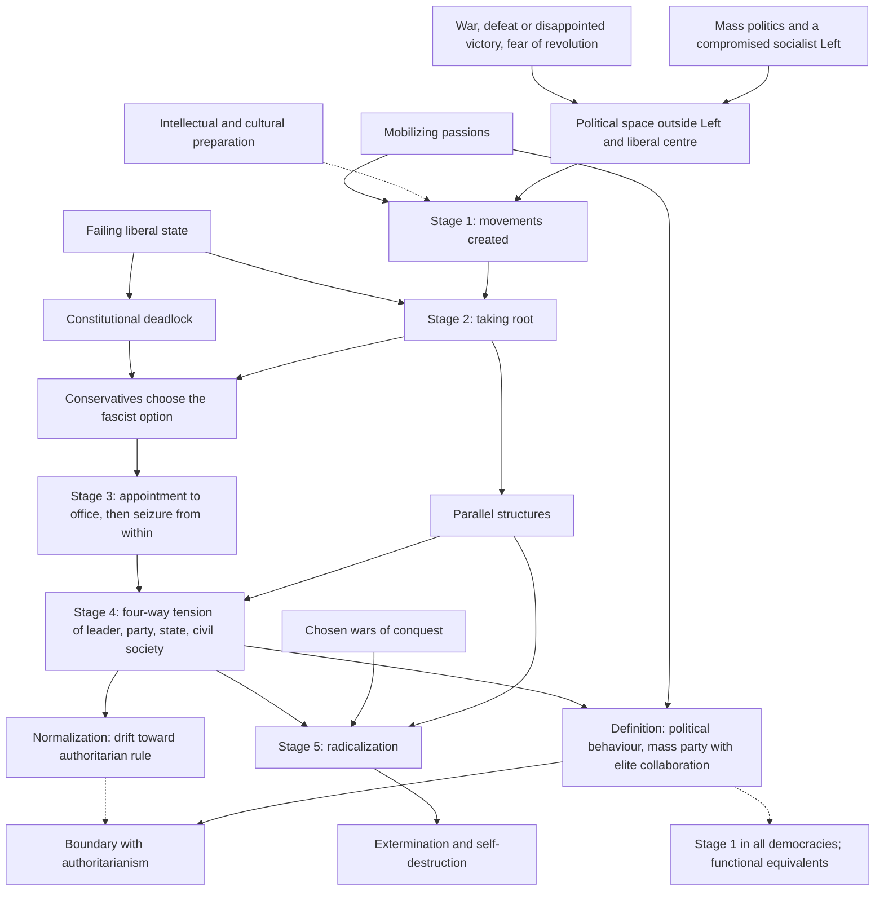

# Synthesis: The Anatomy of Fascism

Reading purpose: "Understand and critically evaluate Paxton's account of fascism in full, and leave notes solid enough to support later cross-book thematic syntheses." The purpose is inferred from this repository's use, not stated by the reader.

Page numbers are `[[page N]]` markers in this workspace's `source.txt` (500-word synthetic pages). Statements marked as assessment are this synthesis's judgment, not Paxton's.

## 1. What is the book about as a whole?

It is a comparative history of how fascism worked, written against the habit of defining fascism by its ideas. Paxton's stated method is to look at what fascists did at least as much as at what they said (p. 8), to give as much attention to their allies and accomplices as to the fascists (p. 1), and to follow fascism as a process through five stages: the creation of movements, their rooting in the political system, the arrival in power, the exercise of power, and a long term in which a regime either radicalises or decays (p. 18).

The book starts with a strategy instead of a definition (p. 12) and gives the definition only at the end: fascism is a form of political behaviour, marked by a preoccupation with community decline and victimhood and by cults of unity, energy and purity, in which a mass-based party of nationalist militants, collaborating with traditional elites, gives up democratic liberties and pursues internal cleansing and external expansion by violence (p. 174).

The unifying claim is that at every stage after the first, the outcome depended less on fascist doctrine or on the leader than on the setting and on choices made by other people: a liberal state in crisis, and conservatives who preferred fascists to the Left. Only Italy and Germany ran the whole course, and only Nazi Germany reached full radicalization (p. 119).

## 2. What is said in detail, and how?

**Method (ch01).** Fascism was a new thing in the twentieth century: dictatorship against the Left with popular enthusiasm (p. 2). The familiar images of the all-powerful leader and the chanting crowd hide the accomplices (pp. 6-7). Fascism's relation to ideas differs from that of liberalism or socialism: it rests on feelings, treats truth as whatever serves the group, and wrote its doctrine after it had power (pp. 12-14). In power, fascists carried out their threats against the Left and not their threats against capitalism (p. 8). Paxton keeps the generic term, against the view that each national case should simply be named separately (pp. 16-17), and proposes the five stages as the way to compare like with like (p. 18).

**Stage one: creation (ch02).** The First World War did not create fascism; it opened the space for it (p. 22). The intellectual and cultural roots usually stressed made fascism imaginable but did not bring it about, and a direct pedigree from thinkers to regimes is an invention (pp. 30-31). What defines fascism is the function its themes serve, not the themes, which each national culture supplies for itself, including its choice of enemy (pp. 29, 31). Beneath the programmes lie nine mobilizing passions (pp. 32-33). The structural preconditions are mass politics and a socialist Left that has shared in government and disappointed part of its following (pp. 33-34). Most movements never got past this stage (p. 42).

**Stage two: taking root (ch03).** A movement takes root when it becomes the carrier of real interests and grievances and can reward ambition (p. 43). Paxton's cases are the Po Valley in 1920-22, where squads did for landowners what the liberal state would not (pp. 46-48); Schleswig-Holstein, where the Nazis won farmers after an urban strategy failed (pp. 50-51); and France, where a strong far Right did not break through because the state and conservative organisations held (pp. 53-57). The movement is reshaped as it grows into the available space (p. 50). Success required a comparable crisis, an opening of political space, skill at alliances, and cooperation from elites (p. 59). Fascism is a product of weak or failed liberal states (p. 64), and it built parallel structures that challenged the state's monopoly of force (pp. 67-68).

**Stage three: getting power (ch04).** Neither Mussolini nor Hitler seized power. The March on Rome was a bluff that the king declined to call (pp. 68-71); Hitler was appointed after a backstairs deal when his vote was already falling (pp. 75-76). Neither won a majority in a free election, and no insurrectionary coup has brought fascists to power (pp. 76-77). Conservatives held the keys and chose the fascist option among others available (pp. 81, 83). The indispensable opening was the deadlock of constitutional government, which fascism exploited but did not solely cause (pp. 84, 93). The real seizure came afterwards, from inside office, and allies then needed only to acquiesce (p. 84). Where conservatives could rule alone, they did, and fascists were kept as junior partners or crushed (p. 88).

**Stage four: exercising power (ch05).** No dictator rules alone, and there has never been an ideologically pure fascist regime (pp. 94-95). Paxton adopts Fraenkel's dual state, a law-bound normative state beside a rule-free prerogative state, and widens it to a four-way tension among leader, party, state apparatus and civil society (pp. 96-98). The result is the characteristic mix of activism and shapelessness (p. 98). Leadership rests on charisma, which is brittle (p. 100). Terror was real but selective, and the opposition of popularity and terror is too rigid; most people accommodated (pp. 107-108). The regimes left property and social hierarchy largely alone and transformed the citizen's relation to public power (pp. 112-113). Economic policy served political and military ends, and fascism was not a developmental dictatorship (pp. 115-117).

**Stage five: radicalization or entropy (ch06).** Fascist regimes could not settle down (p. 117). Those that damped themselves down, like Franco's and Salazar's, were authoritarian (pp. 118-119). Mussolini as ruler mostly strengthened the state against the party (pp. 120-121). Radicalization came from the leader together with pressure from party militants in a system of rival power centres, and above all from war, which both leaders chose (pp. 121-124). The murder of the Jews developed step by step through local initiative, failed intermediate plans and the lawless space of the conquered east, with Hitler's responsibility central (pp. 126-130). Italy shows the same forces more weakly in Ethiopia, the 1938 racial laws and Salò (pp. 131-135). Radicalization is fascism at its most distinctive and is not rational (pp. 135-136).

**The test and the definition (ch07, ch08).** A future fascism would not wear the old symbols; it should be recognised by how it works (pp. 138-139). The early stages exist everywhere; reaching the second stage requires elite toleration, and since 1945 only parties that normalised themselves have approached it (p. 139). Paxton denies the label to regimes with no failed democracy behind them (p. 153), to Vargas and Perón (p. 157), to imperial Japan (p. 160) and to Western client dictatorships (p. 160), and calls Milosevic's Serbia a functional equivalent (p. 152). The last chapter rejects or qualifies the main rival interpretations (pp. 165-172), draws boundaries with tyranny, military dictatorship and authoritarianism (pp. 172-174), gives the definition (p. 174), repeats the nine passions (pp. 174-175), and says the first stage exists in every democracy (p. 175).

**How the argument is made.** By comparison of outcomes: the same movement type in different settings, with success and failure explained by the setting and the allies. The evidence is secondary, drawn from monographs, and Paxton's verdicts on that literature are in the bibliographical essay (pp. 175-203) and the endnotes (pp. 203-257). He favours the line of Fraenkel, Neumann, Broszat and Mommsen on how the regimes worked (pp. 183-184), and is cool toward definition-first work such as Griffin's (p. 176).

## 3. Is it true, in whole or in part?

Assessment throughout this section.

**Well supported.**

- The route to power. The claims that neither leader seized power, that neither won a free majority, and that both were appointed by a head of state on conservative advice are documented with numbers and are the book's firmest ground (pp. 68-77). The endnote on the March on Rome gives the figures (p. 227).
- The selectivity of fascist anticapitalism and the limits of business backing before power (pp. 43, 51-52), though an endnote concedes exceptions such as Daimler (p. 223).
- The regime as a negotiated, disorderly coalition, with selective terror and wide accommodation (pp. 96-108). This is the consensus of the German and Italian monographs he cites.

**Incomplete.**

- The later stages rest on two cases, and the last on one. Paxton says so: comparison at the radicalization stage is hardly possible (p. 135), and the generalisation about conservative allies holds for the cases so far known (p. 78). The stage model is therefore close to a description of Italy and Germany from stage three onward, and the comparative cases show that fascists without allies failed, which supports necessity and cannot show sufficiency (ch04 note).
- The alternative of entropy has no clean example. Franco and Salazar are, on Paxton's account, authoritarian from the start (pp. 118-119). Italy drifted and was pulled back by war. The claim that fascist regimes cannot stabilise has not been observed to fail or to hold (p. 136).
- Structure against choice. Preconditions are listed at length and then said to determine nothing (pp. 63, 68, 81). That makes the account persuasive after the fact and weak as prediction. It also blunts his own comparative test: he rejects rival theories because they cannot explain why Germany and Italy and not France or Britain (pp. 166-167, 170), but an account in which choice can override setting is hard to refute the same way (ch08 note).
- Political space is mostly identified through the outcome it explains (ch03 note, on pp. 56-59).
- Consent is inferred from sources shaped by dictatorship, and accommodation is a weaker thing than consent (ch05 note, on pp. 107-112).

**Internally strained.**

- The definition fits stages three to five: a mass party, effective collaboration with elites, liberties abandoned (p. 174). Yet Paxton says fascism according to this definition exists at the first stage in all democracies (p. 175). What exists at that stage is behaviour in keeping with the passions; the passions, not the definition, carry the early stages (ch08 note).
- The definition's genus is behaviour, but its first clauses and the passions are states of mind. Paxton concedes that choices lead back to ideas (p. 174). Because the passions are deduced from the actions they explain, they cannot be checked independently.
- Parallel structures are called a defining characteristic (p. 68) and used to exclude Vichy (p. 174), and are absent from the definition.
- The boundary with authoritarianism is called essential (pp. 172-173) and is conceded in an endnote to be blurred in practice (p. 256). Franco's regime of 1939-45 is placed on the authoritarian side largely by what it became later (p. 173); another endnote calls the opposite reading brilliant (p. 240).
- The French case needs La Rocque's party to be either not fascist or a failure, though Paxton reports it was probably the largest French party by 1939 (pp. 54-55).
- In ch07 the test shifts between cases: Serbia is admitted on what the regime did (p. 152), Perón and Japan are excluded on how they came to power and what they rested on (pp. 157, 160).
- Anti-Semitism is treated as instrumental, not essential, a commitment stated most plainly in an endnote (p. 206). It fits Italy before 1938 and sits uneasily with the weight the Holocaust carries in ch06.

**Cannot verify from this reading.**

- Paxton dates the Soviet famine to 1931 and says it struck Russians with equal severity (p. 169). The claim is contested elsewhere and was not checked.
- Readers flagged probable slips of date and office: von Papen's chancellorship and the lifting of the SA ban (pp. 75, 78), two dates for the March 1933 election (pp. 76, 85), an endnote naming Funk and Goering as the other Nazis in Hitler's first cabinet (p. 229), Italian Somaliland glossed as Eritrea (p. 131), Albania grouped with Greece as attacked in autumn 1940 (p. 124). These rest on the readers' background knowledge, not on any outside source consulted for this workspace. None bears on the argument, but dates from ch04 and ch06 should be checked before reuse.
- The post-1945 survey is a snapshot of about 2002 (pp. 139-150).

**Overall.** The negative theses are strong: fascism was not the application of a doctrine, not a seizure of power, not the tool of capital, not a monolith, and not explained by any one class. The positive model is a well-argued account of two cases with a plausible but lightly tested extension to others. The definition is best read the way Paxton offers it, as a snapshot (p. 174), with the stages and the conditions at each one doing the real work.

## 4. What of it?

Against the purpose of evaluating the argument and supporting cross-book synthesis:

- **The usable core is conditional and stage-specific.** For any claim about fascism, ask which stage it is about. Paxton's point is that the tools that explain one stage mislead at another (p. 18): ideas for origins, elite choice for the arrival in power, administrative rivalry and war for radicalization.
- **The diagnostic he leaves is about conservatives and institutions, not about symbols.** The warning signs are deadlock, conservatives looking for tougher allies and borrowing fascist techniques, and tolerance of lawless treatment of designated enemies (pp. 164, 175). There is no test by dress or slogan (p. 139).
- **For comparison with Hayek (`road-to-serfdom`).** Paxton's fascists keep property and hierarchy, subordinate economics to politics, and come to power with conservative and business accommodation against the Left (pp. 8, 112-113, 115). That is a direct counter-account to deriving Nazism from socialism or planning. His objection to the totalitarian model, that it ignores shared rule with elites and difference of aims (pp. 169-170), applies to any equation of Nazism with Soviet communism.
- **For comparison with economic histories of the Nazi regime (`wages-of-destruction`).** The claims to test are that politics trumped economics, that business adapted to autarky for business reasons, and that radicalization was not rational war mobilisation (pp. 115-116, 135-136).
- **For themes on democratic breakdown.** The transferable propositions are that the crisis of the liberal state comes first and is partly independent of the fascists (p. 93); that established conservatives decide the outcome (p. 83); and that functioning institutions close the space (p. 57).
- **What not to take from it.** A checklist. The nine passions are widely quoted as one, but Paxton presents them as feelings inferred from conduct, and the definition as a short handle. Used apart from the stages and the conditions, they will match far more than he would call fascist.

## Concept map

Solid arrows are steps the text argues with cases. Dotted arrows are steps it asserts, qualifies, or supports weakly: ideas as a cause, the reach of the definition to the first stage and to the present, and the line between a normalised fascist regime and an authoritarian one.

## Verification log

Mechanical check: `verify-quotes.sh` — 234 checked, 234 ok, 0 near, 0 fail, 0 skipped → nothing outstanding. The readers ran the check on their own notes before reporting and fixed what it flagged in their files.

Hand-verified paraphrased claims (the most load-bearing), each re-read on the cited page:

- ✓ verified — The five stages are creation, rooting, seizure of power, exercise of power, and a long duration ending in radicalization or entropy (p. 18) — the numbered list is on p. 18.
- ✓ verified — Only Nazi Germany experienced full radicalization (p. 119) — stated on p. 119, with the eastern war as the condition.
- ✓ verified — German voters never gave the Nazis a majority, and no insurrectionary coup has brought fascists to power (pp. 76-77) — the first on p. 76, the second on p. 77.
- ✓ verified — The route to power has always passed through conservative elites, hedged as holding for the cases so far known (p. 78) — both the claim and the hedge are in one sentence on p. 78.
- ✓ verified — After appointment the allies needed only to acquiesce (p. 84) — on p. 84, where this is called the real seizure of power.
- ✓ verified — The collapse of the liberal state is partly separate from the rise of fascism (p. 93) — stated on p. 93.
- ✓ verified — Parallel structures are called one of the defining characteristics of fascism (p. 68) — on p. 68.
- ✓ verified — Comparison at the radicalization stage is hardly possible because one regime reached it (p. 135) — on p. 135.
- ✓ verified — Prolonged radicalization has never been witnessed and succession is hypothetical; the normal successor is decay into authoritarianism (p. 136) — on p. 136.
- ✓ verified — The authoritarian-fascist border is conceded to be blurred in practice (p. 256), and an endnote calls the reading of Franco's Spain as fascist to 1945 brilliant (p. 240) — endnote 65 of ch08 and endnote 4 of ch06.
- ✓ verified — La Rocque's party was probably the largest in France on the eve of the war, with the size admitted to be hard to measure (p. 55) — on p. 55.
- ✓ verified — Paxton sees anti-Semitism as instrumental (p. 206) — endnote 35 of ch01.
- ✓ verified — Milosevic's Serbia is called a functional equivalent, though the label is said to explain nothing (p. 152) — on p. 152.
- ✓ verified — Since 1945 the second stage has been reached, if at all, only by parties that normalised themselves (p. 139) — on p. 139, limited to areas outside the former Soviet sphere.
- ✓ verified — The warning signs are deadlock, conservatives seeking tougher allies, and conservatives borrowing fascist techniques (p. 164) — on p. 164.
- ✓ verified — The Soviet famine is dated 1931 and said to have affected Russians with equal severity (p. 169) — the text says this on p. 169; whether it is right was not checked.
- ✓ verified — Daimler is named as a major backer in an endnote (p. 223) — endnote 41 of ch03.

Limits of this read: the analytical pass was done by five readers in separate contexts, each checking its own notes against the text. This synthesis was written from their notes and reports; I read the preface and ch08 in full myself and otherwise re-read only the pages listed above. Endnotes were read in full for ch04 and ch06, skimmed in full for the `ap02` note, and sampled by the other chapter readers. Cross-references between units that a reader could not confirm are marked in the notes with words such as expected or presumably. The readers' accuracy flags on dates and offices in ch04 and ch06 rest on their background knowledge and were not checked against an outside source. Section 4 names other books in this repository as comparison points; their notes were not opened for this synthesis.
