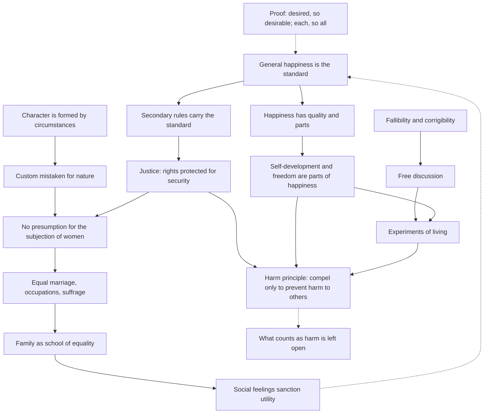

# Synthesis: The Basic Writings of John Stuart Mill

Reading purpose: "Understand what Mill argues in each of the three works, how the arguments are built, how the works bear on one another (liberty, equality of the sexes, utility), and where they are contestable."

Written from the notes in `notes/`, not from the raw text. Page numbers are `[[page N]]` markers in this workspace's `source.txt`.

## 1. What is the book about as a whole?

The volume collects three essays that answer one question: what may a society rightly require of its members? Utilitarianism gives the standard, the general happiness (p. 196). On Liberty and The Subjection of Women apply it to two forms of power that Mill thinks his age wrongly accepts: the power of majority opinion over individual lives (p. 11) and the legal power of men over women (p. 104).

The editor's introduction presents the three as one project, with On Liberty at the centre, Subjection as illustration and Utilitarianism as ground (p. 4). The texts bear this out in part. On Liberty says it appeals to utility and forgoes abstract right (p. 16). Subjection says the question is one of consequences for humanity without distinction of sex (p. 121). Utilitarianism names the 'aristocracies of colour, race, and sex' as injustices in the course of being recognised (p. 245) and includes wrongful interference with freedom among the harms that justice forbids (p. 242).

## 2. What is said in detail, and how?

### The standard

- Actions are right as they tend to promote happiness, meaning pleasure and absence of pain, for all concerned and not for the agent alone (pp. 196, 200).
- Pleasures differ in quality. The test is the preference of those who know both, and they prefer the life that uses the higher faculties (pp. 197-198).
- The principle is applied through secondary rules, the accumulated experience of mankind. First principles are needed only when those rules conflict (pp. 211-212).
- The motive to obey it is conscience, which can be attached to utility because utility fits the social feelings, and those grow as society becomes more equal (pp. 216, 218).
- The only evidence that something is desirable is that people desire it. People desire happiness, and whatever else they desire for itself, virtue included, they desire as a part of their happiness (pp. 221-224).
- Justice is the part of morality in which an assignable person has a right. A right is what society ought to protect, and the reason is utility, above all the utility of security (pp. 234, 237).

### Liberty

- The danger in a democratic age is social tyranny, the pressure of prevailing opinion, more than bad law (p. 11).
- The principle: power may be used over a competent adult against his will only to prevent harm to others. His own good is a reason for persuasion and never for compulsion (p. 15).
- Opinion must be free on all three hypotheses. A silenced opinion may be true; if false it keeps the truth alive; most often it holds part of the truth (pp. 20, 35, 44).
- Conduct must be free because faculties grow only by choice, people differ in what suits them, and new and better ways of living are found only by trial (pp. 55, 63, 60).
- The line falls at injury to interests that ought to count as rights and at breach of assignable obligations. Remote or 'constructive' injury is to be borne for the sake of freedom (pp. 69, 74-75).
- Harm to others is necessary for interference and not sufficient (p. 85).

### Equality of the sexes

- The legal subordination of women is wrong in itself and should give way to perfect equality (p. 104).
- Custom gives it no support, because it was never chosen on evidence. It is the law of the strongest surviving in one relation (pp. 107-108).
- Nothing can be known of the natures of the sexes while they are seen only in the present relation, and nothing needs to be known, since free choice and competition will settle what each can do (pp. 121, 126).
- In law the wife is a bond-servant. The power is given to every man, and institutions must be fitted to bad men (pp. 129, 133).
- The suffrage is due to women as a means of self-protection, whatever their capacities (p. 148).
- Equality would make the family a school of justice, double the talent available, and give women the direct happiness of rational freedom (pp. 142, 175, 187).

### How the three depend on one another

Each applied essay needs something from Utilitarianism that Utilitarianism only partly supplies. On Liberty needs a conception of happiness in which self-development is a component and not only a means: 'utility in the largest sense, grounded on the permanent interests of man as a progressive being' (p. 16). Utilitarianism offers the higher pleasures (p. 197) and the doctrine that things desired for themselves are parts of happiness (p. 222). Subjection uses exactly this when it calls freedom the first want of human nature after food and raiment and an element of happiness (p. 187). On Liberty also needs rights that hold against case-by-case calculation; Utilitarianism V provides them as the most binding class of utilities (p. 242), with an exception for extreme cases (p. 245).

The works also share a psychology. Character is made by circumstances and relations. Custom is mistaken for nature (pp. 12, 114). Power corrupts those who hold it (pp. 62, 134). Equal association is what teaches regard for others (pp. 140, 218).

## 3. Is it true, in whole or in part?

### What holds

- The argument for free discussion from fallibility and corrigibility is strong and does not assume that truth wins. Mill denies that it does (p. 30) and rests the case on suppression removing the means of correction (p. 23).
- The debunking of custom in Subjection is sound as far as it goes. It removes a presumption and Mill says more than once that it does not by itself show the system wrong (pp. 112, 113).
- The suffrage argument stands independently of every disputed claim about capacity (p. 148).
- The account of justice explains both why rights feel absolute and why accepted maxims of justice conflict (pp. 238-241).

### Where the author is wrong or overreaches

- Mill calls the liberty principle 'one very simple principle' (p. 15). His own text shows it is neither: harm is never defined, the test shifts from harm to interests to rights to assignable obligation (pp. 15, 69, 75), indecency is prohibited although offence is elsewhere denied to be injury (pp. 89, 77), and the interested-instigator case is left undecided (p. 90). The editor makes the same criticism (p. 248).
- The proof slides from what is desired to what is desirable, and from each person's happiness being a good to that person to the general happiness being a good to the aggregate (p. 221). The second step gets one clause.
- The claim that nothing is desired except happiness is saved by counting anything desired for itself as a part of happiness (p. 224), which risks making it true by definition while Mill calls it a question of fact (p. 224).
- After denying that anything can be known of women's nature (p. 123), Mill generalises at length about women's practical bent and speculates about brain physiology (pp. 152, 160). He flags the speculation as hypothetical, but the conclusion that circumstances completely explain all differences implying inferiority (p. 169) exceeds his own agnosticism.
- The claim that all selfish propensities have their root in the relation between the sexes (p. 173) is asserted, not argued.

### Where the author is incomplete

- Mill endorses the customary division of labour in marriage (pp. 144-145) while saying earning power is essential to a woman's dignity (p. 145) and that household duties leave women no time of their own (p. 168). The editor reports later feminist criticism as just (p. 264).
- Divorce is set aside twice (pp. 131, 145), though the argument that brutality cannot be checked while the victim stays in the offender's power points to it (p. 133).
- No rule is given for when social disapproval is a permitted 'natural penalty' and when it is the tyranny of opinion (pp. 71-72).
- The exclusion of 'barbarians' and the ranking of civilizations (pp. 16, 65-66) rest on historical assertions with almost no evidence.

### What I cannot verify

- Mill's statements of English marriage law (pp. 129-131); the editor's notes support them in outline (p. 263).
- Mill's testimony about women regents in Indian states (p. 171) and his summary dismissal of Kant (pp. 194, 236).
- Three dates in the editor's notes that look wrong (pp. 249, 251, 254); see `notes/ap01-notes-and-commentary-on-liberty.md`.

## 4. What of it?

Against the reading purpose:

- **What each work argues.** On Liberty: compulsion only to prevent harm to others, with opinion nearly absolute and conduct free in what concerns oneself. Subjection: legal equality in marriage, occupation and the vote. Utilitarianism: general happiness as the standard, applied through rules and rights.
- **How the arguments are built.** On Liberty and Subjection both shift the burden of proof onto whoever would restrict (p. 105), then remove the opponent's support (custom, alleged nature, alleged usefulness of suppression), then argue from benefits. Utilitarianism clears away misreadings before offering considerations for the principle.
- **How they bear on one another.** The applied essays are consistent with Utilitarianism only on its broad reading of happiness. If that reading fails, they need another foundation. Schneewind thinks one is available and that Mill's conclusions could be as strongly linked to other moral principles (p. 7). That is the editor's judgment, not Mill's.
- **Where they are contestable.** The definition of harm; whether quality of pleasure and parts of happiness stay within hedonism; the two inferences in the proof; and Mill's residual assumptions about women's domestic role.

A reader who wants one thread should follow the idea that people become what their relations make them. It carries the case for free discussion, for individuality, for equal marriage, and for the claim that utilitarian motivation is possible at all.

## Concept map

Solid arrows are steps the text argues. Dotted arrows are steps it asserts or supports weakly.

## Verification log

Mechanical check: `verify-quotes.sh` — 169 checked, 169 ok, 0 near, 0 fail, 0 skipped → nothing outstanding. The run covers all 18 notes, including the commentary note on Utilitarianism added last; it reported no FAIL or NEAR lines, so no quotation or page number needed correcting.

Hand-verified paraphrased claims (the most load-bearing), each checked against the cited page while the chapter was being read and noted:

- ✓ verified — The harm principle is stated as the sole warrant for compulsion, with a person's own good excluded (p. 15) — the sentences are on p. 15 in those terms.
- ✓ verified — Mill forgoes abstract right and appeals to utility in the largest sense (p. 16) — stated on p. 16.
- ✓ verified — Harm to others is said not always to justify interference (p. 85) — opening of Chapter V.
- ✓ verified — Mill denies that truth has inherent power against persecution (p. 30) — he calls the belief idle sentimentality on p. 30.
- ✓ verified — Quality of pleasures is tested by the preference of those acquainted with both (pp. 197-198) — the test spans the page break.
- ✓ verified — The step from each person's happiness to the general happiness occupies one clause (p. 221) — confirmed.
- ✓ verified — A right is what society ought to defend, for no other reason than general utility (p. 237) — both sentences on p. 237.
- ✓ verified — Wrongful interference with freedom is included among the hurts justice forbids (p. 242) — parenthesis on p. 242.
- ✓ verified — Mill denies that anyone can know the nature of the sexes (p. 121) and later calls his physiological conjecture entirely hypothetical (p. 160) — both confirmed.
- ✓ verified — Mill thinks the common division of labour in marriage generally most suitable (pp. 144-145) — confirmed across the page break.

Limits of this read: one reader read fm01, ch01-ch14, ap01 and ap02 in full in a single sequential pass and wrote each note directly after its chapter. That reader ran out of context before the commentary on Utilitarianism (ap03, pp. 268-304), which a second reader read and noted separately; this synthesis was written before that note existed and does not draw on it. The cross-chapter ledger `terms.md` was compiled by the second reader from the notes. The hand-verified items above were checked at the time of reading and not re-read afterwards.
