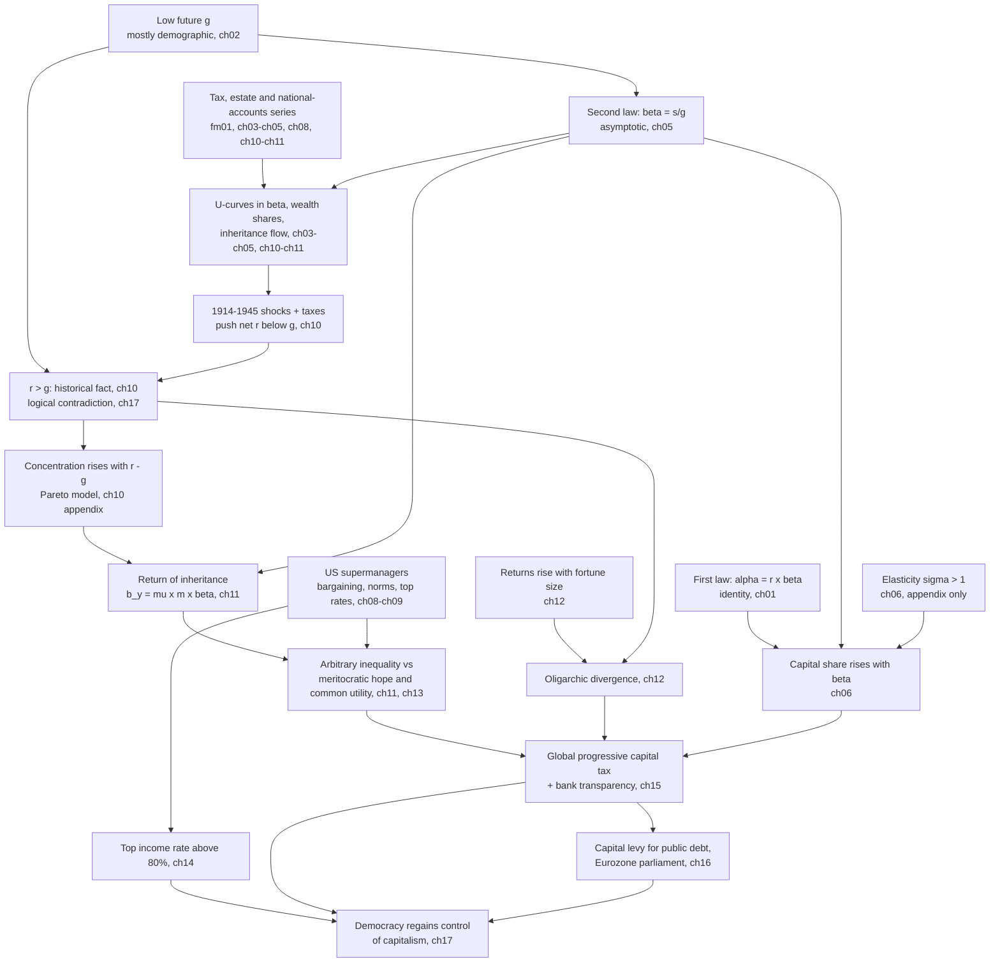

# Synthesis: Capital in the Twenty-First Century

Reading purpose: "Understand and critically evaluate Piketty's argument in full, and leave notes solid enough to support later cross-book thematic syntheses." Confirmed by the reader.

Page numbers are `[[page N]]` markers in this workspace's `source.txt` (500-word synthetic pages, not printed pages). Unit notes are in `notes/`; the ledger of terms is `terms.md`. Endnotes run pp. 432–513; most of Piketty's models and source descriptions sit in an online technical appendix that is not part of this file, and several claims below are flagged because the book itself only points there.

## 1. What is the book about as a whole?

The book asks the Marx-versus-Kuznets question: does private capital accumulation lead to ever greater concentration of wealth, or does development itself bring inequality down (p. 3)? Piketty answers with long statistical series, mostly tax, estate and national-accounts data for more than twenty countries over three centuries, organised by a deliberately small theoretical apparatus (p. 29). He calls the result "as much a work of history as of economics" (p. 28).

His answer is neither Marx's nor Kuznets's. The knowledge-driven forces of convergence have avoided the Marxist apocalypse, but when the return on capital exceeds the growth rate "capitalism automatically generates arbitrary and unsustainable inequalities" (p. 3). The twentieth-century compression of inequality was not a stage of development but the product of wars, depression and the policies they made possible (ch10 pp. 257, 268-273). With growth slowing, the nineteenth-century configuration is likely to return, and democracy can regain control only through new fiscal institutions, above all a progressive global tax on capital (ch15 pp. 378-381; ch17 pp. 427-428).

It is two books bound together. Parts One to Three are positive economic history: they establish the U-curves and explain them. Part Four is political economy in Piketty's normative sense (ch17 pp. 428-429): it prescribes a social state, confiscatory top income rates, a capital tax and a democratised Eurozone. A reader has to keep apart three layers throughout: the series themselves, the accounting identities that organise them, and the behavioural and political claims Piketty draws from both.

## 2. What is said in detail, and how?

### The main line

1. **Concepts and background (fm01, ch01–ch02).** Capital is all non-human, marketable wealth at market value (ch01 pp. 36-39). The capital/income ratio β measures it in years of national income; the capital share α is capital income over national income; the first fundamental law α = r × β is an identity (ch01 pp. 40-45). Long-run frontier growth has never been sustained much above 1–1.5% per capita, and the expected fall in global growth to about 1.5% after 2050 is mostly demographic (ch02 pp. 59, 70-76).
2. **The U-curve of β (ch03–ch04).** In Britain and France β was about six to seven years of income from the eighteenth century to 1914, fell by nearly two-thirds in 1914–1945 and has more than doubled since (ch03 p. 85). Capital changed form, from land to housing and business capital, without losing weight. Germany and the US show shallower curves; in the US the "low-capital New World" holds only if slaves are excluded (ch04 pp. 108, 114-115).
3. **The second fundamental law (ch05).** In the long run β = s/g. Piketty states that it is asymptotic, covers only accumulable capital, and assumes relative asset prices are neutral over the long run (p. 120). Slow growth with continued saving explains most of the post-1970 rise in rich countries, with asset prices accounting for one-quarter to one-third (p. 137) and privatisation for a further share of private wealth (p. 133). Extrapolated, global β approaches seven years by 2100 (p. 140).
4. **The capital share (ch06).** Whether a higher β raises α depends on how fast r falls as capital accumulates. With an elasticity of substitution above one, the volume effect wins; Piketty estimates it at "between 1.3 and 1.6" (p. 160) and concludes that "no self-corrective mechanism exists" to stop α rising with β (p. 161).
5. **The structure of inequality (ch07–ch09).** Capital is always more unequally distributed than labor (ch07 pp. 175-177). France's twentieth-century compression came entirely from the collapse of top capital incomes (ch08 pp. 196-200). The US rise since 1980 is mainly a labor-income story: supermanagers whose pay is set largely by bargaining and social norms, amplified by falling top tax rates (ch08 pp. 217-219; ch09 pp. 239-244). Piketty says outright that the two opening figures reflect "two distinct underlying phenomena" (p. 21).
6. **The divergence mechanism (ch10).** The pre-1914 hyperconcentration of wealth (top decile 80–90%, top centile 50–60%) is explained by r > g: with r about 5% and g about 1%, saving a fifth of capital income keeps a fortune growing with the economy (p. 254). Once r durably exceeds g, accumulation and transmission "automatically lead to a very highly concentrated distribution" (p. 263). Shocks to capital, taxes and low net returns in 1913–1950 pushed net r below g for the first time (p. 257). Piketty takes r > g to be "a historical fact, not a logical necessity" (p. 255).
7. **Inheritance and merit (ch11).** The annual inheritance flow b_y = μ × m × β fell from about 20–25% of national income in the nineteenth century to under 5% in the 1950s and is returning toward nineteenth-century levels (ch11 pp. 275-291). Fiscal and economic estimates agree (p. 277). Rastignac's dilemma, whether a top inheritance beats a top career, was decided for inheritance in the nineteenth century, for work in cohorts born 1910–1960, and is roughly balanced for cohorts born in the 1970s (pp. 295-297). The emerging society is one of many petits rentiers rather than a few great ones (p. 306).
8. **Global wealth (ch12).** Returns rise with fortune size, through economies of scale in portfolio management (pp. 313-314, 327-329), which amplifies r > g at the top. The more likely future is "oligarchic divergence", every country increasingly owned by the world's very rich, not international divergence (p. 339).
9. **Policy (ch13–ch16).** The social state should be modernised, not dismantled; its justification is "common utility", which Piketty reads in a Rawlsian way (ch13 pp. 345-352, 349). The optimal top income tax rate "is probably above 80 percent" (ch14 p. 376). A progressive annual tax on net wealth with automatic exchange of bank information is a "useful utopia" whose primary purpose is "not to finance the social state" but to regulate capital (ch15 pp. 378-381). Public debt should be reduced by a one-off progressive capital levy rather than by inflation or austerity, within a democratised Eurozone (ch16 pp. 400-417).
10. **Conclusion (ch17).** r > g is restated as "a fundamental logical contradiction" (p. 427): "The past devours the future." (p. 427). Economics should be political and historical economy (pp. 428-431).

### How the argument is built

- **Series first, then identities, then behaviour.** The book's empirical spine is the U-curve in β, in top wealth shares and in the inheritance flow. The identities α = r × β and b_y = μ × m × β organise those series, and they are true by construction (ch01 p. 42; ch11 p. 278). The behavioural claims that do the predictive work, σ > 1 (ch06) and the r − g concentration model (ch10), are carried by models whose equations sit in the online appendix (ch06 note 24, p. 453; ch10 notes 25-26, pp. 466-467).
- **Literature as evidence.** Balzac and Austen are used to fix orders of magnitude for rentier life (fm01 p. 3; ch07 pp. 171-173; ch11 pp. 295-297). They illustrate rather than prove; the series do the proving.
- **France as the reference case.** France's universal estate records since 1791 (ch10 p. 245) give the longest wealth and inheritance series, and much of the general argument is a French result extended where other countries' data allow.
- **Hedged method, unhedged summaries.** The book opens and closes with disclaimers: the answers are "imperfect and incomplete" (p. 3) and all conclusions are "by nature tenuous" (p. 426). The chapter summaries are often firmer than the evidence in the chapter (see section 3).

### Concept and argument map

The map shows two separate routes to Part Four. The capital route (β = s/g, r > g, inheritance, oligarchic divergence) leads to the capital tax. The labor route (supermanagers) leads to the confiscatory income tax. They meet only at the normative node, arbitrary inequality judged against common utility, which is why the book's unity depends more on its moral frame than on a single mechanism.

## 3. Is it true, in whole or in part?

Following the skill's etiquette, three verdicts are kept apart: wrong, incomplete, and cannot verify.

### Where the book is strongest

- **The series.** The U-curve in β and in top wealth shares, and the French inheritance flow, are built from sources that are described, cross-checked and published, and the book is candid about their limits: tax returns understate capital income, so top shares are lower bounds (ch08 p. 204); household surveys are "misleadingly complacent" (ch09 p. 239); bank wealth reports are useless for trends (ch12 p. 318). The empirical contribution stands independently of the theory.
- **The patrimonial middle class.** The rise of a middle 40% owning a quarter to a third of wealth is "no doubt the most important structural transformation" in the long-run distribution (ch10 p. 244), and Piketty consistently uses it to temper his own forecasts: inheritance volume can return without nineteenth-century concentration (ch11 pp. 304-307).
- **The identities.** α = r × β and b_y = μ × m × β are true by construction. Their value is in forcing any rival account to say which term moved.

### Where the author is wrong or overstates

- **The status of r > g shifts.** ch10 calls it "a historical fact, not a logical necessity" (p. 255); the Conclusion calls it "a fundamental logical contradiction" (p. 427), one page after saying every conclusion is "tenuous" (p. 426). ch10 also says it holds in the standard perfect-market model (p. 260). The ch10 wording is his considered position; the Conclusion's is rhetoric that his own argument does not support.
- **The capital-share forecast outruns the elasticity estimate.** Piketty's σ of 1.3–1.6 (p. 160) rests on movements inside the U-curve, which were driven largely by war and asset prices, since he attributes the difference between the endpoints to technology (ch06 p. 161). He concedes that the post-1970 rise in α fits rising bargaining power of capital equally well (p. 160), yet still concludes that "no self-corrective mechanism exists" (p. 161). A reader's calculation in `notes/ch06-*.md` suggests σ of 1.3–1.6 gives α of about 29–32% at β of 7–8, short of the 40% upper end of his forecast (p. 169); that calculation is the note-writer's, not Piketty's.
- **"Automatically" versus "by itself sufficient".** The text says r > g will "automatically lead" to high concentration (p. 263); the supporting endnote claims only that the r > g logic is "by itself sufficient to explain the observed level of concentration" (p. 467), and Piketty concedes elsewhere that no evidence fixes each mechanism's share (ch10 p. 254). The weaker claim is the one he defends.
- **Independence of the inheritance estimates.** The fiscal and economic flows are called "totally independent" (ch11 p. 277), but μ in the economic flow is built from wealth-at-death profiles taken from the same probate records (ch11 note). The agreement is evidence of internal consistency more than of independent confirmation.
- **Number slips.** Several are recorded in the notes: the Kuznets drop of "nearly 10 points" that his own figures put near 15 (fm01 p. 12); a compounding example understated by a factor of about eight (ch02 p. 58); German inflation dates that disagree between text and note (ch04 p. 103); "parents' income has become an almost perfect predictor of university access" (ch13 p. 353), which overstates a doubling of access shares. None changes a conclusion.

### Where the author is incomplete

- **β mixes saving and asset prices.** Piketty concedes that the market price of any capital is "largely arbitrary and uncertain" (p. 39) and that it "is always in part a social and political construct" (p. 135), and asset prices account for a quarter to a third of the post-1970 rise (p. 137). Yet β = s/g treats relative prices as neutral in the long run (p. 120). If institutions durably set asset prices, price is a second determinant of β, not noise around s/g. Housing, about half the stock, makes this the decisive gap.
- **Net versus gross saving.** With constant net s, β = s/g has no upper bound as g falls toward zero; the gross form β = s/(g+δ) (ch05 note 12, p. 447) is bounded. The book never says which describes behaviour, and the seven-year global forecast (p. 140) depends on that choice.
- **The US case.** The book's clearest modern rise in inequality, in the US, is driven by labor income, not r > g (ch08 pp. 217-219). Piketty links it back to capital in three ways: capital income still explains about a third of the rise (p. 218), self-set top pay is a force for wealth divergence (ch09 p. 242), and today's earners become tomorrow's rentiers. Only the first is evidenced in the book. His supermanager explanation concedes that firm size matters (ch09 p. 242) but never tests the market-size alternative.
- **The agency gap.** The history says war and depression, not universal suffrage, created progressive taxation (ch10 p. 257; ch14 p. 377). The proposals rely on democratic deliberation and the force of ideas; "the obstacle is political, not technical" (ch15 pp. 383, 391). Piketty admits his "natural optimism" (ch14 p. 377) and that the Cyprus episode shows the capital levy is not currently available (ch16 pp. 413-414), but he does not resolve how the tax arrives without a comparable shock.
- **Inputs to the capital tax.** Its top rates of 5–10% are justified by real returns of 6–7% on the largest fortunes (ch15 pp. 386, 391), taken from the Forbes rankings that ch12 calls deficient and the tax is partly meant to replace (ch15 pp. 379, 381). Its stated purpose is regulation, not revenue (p. 381), yet the European blueprint is presented through revenue estimates (p. 389).
- **Internal contradictions on the US.** ch14 ends with the US possibly "on the verge of becoming the Old Europe" (p. 378); ch15 says immigration keeps it "still a long way from becoming the new Old Europe" (p. 398), explicitly correcting ch14. The Conclusion does not decide.
- **Climate.** Natural capital is called the principal long-term worry (ch16 pp. 424-425) but is never built into β = s/g or the growth baseline.

### Cannot verify from the book

- The elasticity estimate of 1.3–1.6 (ch06 note 24, p. 453 points only to the online appendix).
- The Pareto model linking concentration to r − g, its predicted 90%/50% shares and its thresholds (ch10 pp. 264-265; notes 25-26).
- That wealth is equally concentrated within each age cohort, the decisive point against the life-cycle explanation (ch07 p. 177; note 12, p. 455).
- Whether the inheritance simulation that "successfully accounts for" 1820–2010 (ch11 p. 289) was fitted to that period or tested on it.
- The 80% optimal rate's empirical inputs, which rest almost entirely on one then-forthcoming paper by Piketty, Saez and Stantcheva (ch14 pp. 373-376; note 40, p. 493).

## 4. What of it?

Against the stated purpose, full understanding and critique plus a base for cross-book syntheses:

- **The durable contribution is the data and the accounting frame, not the law.** Anyone writing about wealth after this book has to answer to the U-curves and to the identities that decompose them. The predictive claims (σ > 1, concentration rising with r − g, a seven-year global β) are much weaker and should be cited as Piketty's model results, with their appendix dependence noted.
- **Cite r > g in its ch10 form.** For theme work, the defensible proposition is that net returns exceeded growth for most of history, that they did not in 1913–1950 because of shocks and taxes, and that slower growth makes the old configuration likely again (ch10 pp. 255-257). The "central contradiction of capitalism" of ch17 is a slogan for that proposition, not a stronger result.
- **Keep the two inequality stories apart.** European wealth concentration (ch03–ch05, ch10–ch11) and US labor-income concentration (ch08–ch09, ch14) have different mechanisms and lead to different taxes. A theme note that runs them together will misstate the book.
- **Cross-book hooks with The Road to Serfdom.** Several points meet Hayek directly and are worth a `themes/` note:
  - **Rule of law, turned redistributive.** Piketty wants taxes that are general, predictable and apply equally to everyone (ch12 pp. 324-325), close to Hayek's formal rules, but uses them for the distributive aims Hayek ruled out. He calls the capital tax "the liberal form of capital control" (ch15 p. 397) and the confiscatory income tax a relatively liberal method (ch14 p. 370). The disagreement is over ends and over whether a general progressive rate is a formal rule.
  - **Rules for money, discretion for budgets.** Piketty accepts rule-bound central banks but rejects constitutional debt limits (ch16 pp. 422-423).
  - **Knowledge and markets.** Piketty's marginal productivity is unmeasurable for unique jobs (ch09 pp. 239-240), a claim about dispersed, unobservable information that parallels Hayek's knowledge argument but is used to deny that market pay tracks contribution.
  - **Merit.** Both are suspicious of rewarding by judged merit. Hayek because no authority can judge it; Piketty because "meritocratic extremism" (ch11 pp. 303-304) is the winners' self-justification. Both rely in the end on general rules rather than case-by-case verdicts (ch12 pp. 323-326).
  - **What growth does.** Hayek treats growth and competition as the alternative to planning; Piketty treats growth as the only "natural" equaliser (ch12 p. 314; ch02 pp. 62-63) and argues that the frontier cannot supply enough of it.
- **What to read next for a check.** The genre strategy recommends a second witness for any single history. The obvious checks are on the two load-bearing behavioural claims: the elasticity of substitution (ch06) and the role of housing prices in β (ch05). The notes record where each is argued, so a later syntopical pass can start there.

## Verification log

Mechanical check: `verify-quotes.sh` over the whole workspace returned `{"checked": 733, "ok": 733, "near": 0, "fail": 0, "skipped": 0}` over the unit notes before this synthesis was written, and `{"checked": 750, "ok": 750, "near": 0, "fail": 0, "skipped": 0}` with the synthesis included.

Load-bearing paraphrases re-verified by targeted reading of `source.txt`:

1. ✓ verified — β = s/g is asymptotic and conditional (p. 120): "this is an asymptotic law, meaning that it is valid only in the long run".
2. ✓ verified — elasticity estimate 1.3–1.6 resting on endnote 24 (p. 160), and the bargaining-power concession on the same page (p. 160).
3. ✓ verified — "no self-corrective mechanism exists" (p. 161).
4. ✓ verified — r > g is "a historical fact, not a logical necessity" (p. 255) versus "a fundamental logical contradiction" (p. 427), with "tenuous" (p. 426).
5. ✓ verified — "automatically lead to a very highly concentrated distribution" (p. 263) versus endnote "by itself sufficient" (p. 467).
6. ✓ verified — asset prices explain "one-quarter to one-third" of the 1970–2010 rise in national β (p. 137).
7. ✓ verified — price of capital "always in part a social and political construct" (p. 135).
8. ✓ verified — fiscal and economic inheritance flows called "totally independent" (p. 277).
9. ✓ verified — optimal top rate "probably above 80 percent" with a precision disclaimer (p. 376).
10. ✓ verified — capital tax's primary purpose "not to finance the social state" (p. 381).
11. ✓ verified — US "on the verge of becoming the Old Europe" (p. 378) versus "still a long way from becoming the new Old Europe" (p. 398).
12. ✓ verified — "two distinct underlying phenomena" behind Figures I.1 and I.2 (p. 21).

13. ✓ verified — market prices of capital are "largely arbitrary and uncertain" (p. 39), which Piketty says on the same page is a characteristic of all forms of capital, not just immaterial capital (p. 39). An earlier draft of this log read the phrase as limited to immaterial capital; the context shows the ch01 note's broader reading is correct.
