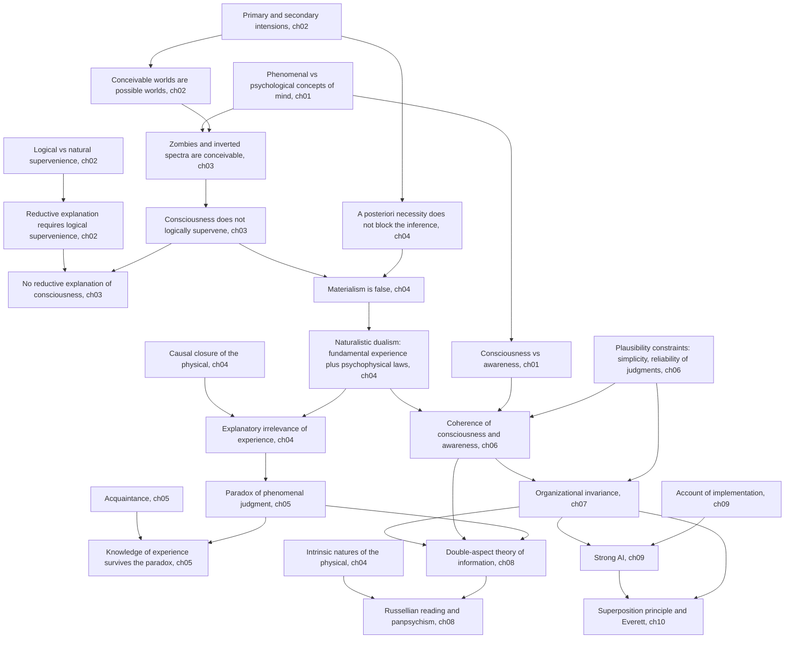

# Synthesis: The Conscious Mind

Reading purpose: "Understand and critically evaluate Chalmers's argument in full, and leave notes solid enough to support later cross-book thematic syntheses." The purpose was inferred from this repository's use, not stated by the reader.

Page numbers are `[[page N]]` markers in this workspace's `source.txt` (500-word synthetic pages). Everything here is drawn from the notes in `notes/` and from `terms.md`. Criticism is mine unless attributed to Chalmers.

## 1. What is the book about as a whole?

The book asks whether conscious experience can be explained in physical terms and, if it cannot, what a theory of it would look like. It gives a negative answer and then a positive programme.

The negative answer: experience does not logically supervene on the physical. All the physical facts could be as they are with no experience at all, so no explanation given wholly in physical terms can account for experience (p. 91), and materialism, defined as the entailment of all positive facts by the physical facts (p. 46), is false (p. 117).

The positive programme: experience is a fundamental feature of the world, connected to physical processes by psychophysical laws that supplement physics without disturbing it (pp. 120-121). Chalmers calls this naturalistic dualism. He offers two higher-level constraints on a fundamental theory: coherence between consciousness and awareness (ch06) and organizational invariance (ch07). He also tentatively proposes that information has both physical and phenomenal aspects (ch08). Two applications follow: the right computation would be conscious (ch09), and the theory supports Everett's interpretation of quantum mechanics (ch10).

Chalmers states the status of the whole himself. The argument is conditional: "if one takes consciousness seriously, the position I lay out is where one should end up" (p. 6). He admits that the antecedent cannot be proved and that past a point the two sides cannot argue across the divide (p. 5). He ranks his own confidence at the end: dualism very likely true, ubiquitous experience weakly held, Everett undecided (p. 333).

## 2. What is said in detail, and how?

The book is built as a chain. Each link is listed with what it needs from the links before it.

**Link 1: two concepts (ch01).** Mental terms have a phenomenal sense (how it feels) and a psychological sense (what it does) (pp. 17-18). The psychological sense can be analysed functionally; the phenomenal sense cannot, because a causal role could be played with no experience (p. 21). The word consciousness is kept for the phenomenal sense and awareness for the functional counterpart, access to information usable in the control of behaviour (pp. 33-34). This division carries the whole book: it is what makes zombies describable, what lets ch05 separate judgments from experiences, and what ch06 then reconnects by law.

**Link 2: the framework (ch02).** B-facts supervene on A-facts when the A-facts determine them (p. 38). Supervenience is logical when the A-facts entail the B-facts, and merely natural when the connection is a contingent law (pp. 39-42). A phenomenon can be reductively explained exactly when it supervenes logically on lower-level facts (pp. 51-52). Chalmers grants that this explication has an element of stipulation (p. 52). Kripke's a posteriori necessities are handled by giving each concept two intensions: a primary one, fixed a priori, saying what the concept picks out if a given world is actual, and a secondary one, rigidified at the actual world (pp. 60-62). Explanation is governed by primary intensions (p. 72). Conceivable worlds are possible worlds; what looks like a gap between conceivability and possibility is a matter of how statements describe worlds (pp. 70-71). Nearly every high-level fact supervenes logically on the physical; the exceptions are consciousness, indexicality, negative facts, and laws and causation (pp. 83-89).

**Link 3: consciousness is the exception (ch03).** Five arguments: a zombie twin is coherent (pp. 92-97); an inverted spectrum is coherent (pp. 97-99); knowledge of consciousness comes from one's own case, so physical knowledge alone would never lead one to posit it (pp. 99-100); Mary knows all the physical facts and not what red is like (pp. 100-101); and no functional or structural analysis of the concept is available (pp. 101-103). The underlying reason is that physical explanation delivers structure and function, and experience is neither (p. 104). Cognitive models, neurobiology, new physics and evolution therefore explain awareness, not consciousness (pp. 108-116).

**Link 4: from explanation to ontology (ch04).** The four-step argument (p. 117): experience exists; a physically identical world without it is logically possible; so facts about experience are further facts; so materialism is false. The strongest reply is that zombies are conceivable but not possible. Chalmers answers that Kripkean necessity only changes how worlds are described, not which worlds there are (pp. 127-128), and that a stronger, brute metaphysical necessity has nothing to recommend it (pp. 130-132). The physical domain stays causally closed (p. 118), so experience is explanatorily irrelevant to behaviour (p. 149). He declines the label epiphenomenalism but accepts a weak form (p. 153), and points to one way out: physics describes only relations, and experience or something close to it may be the intrinsic nature of what physics describes (pp. 146-148). He sorts positions into type A (logical supervenience, so nothing further to explain), type B (no logical supervenience, materialism kept) and type C (property dualism), with a monist variant (pp. 158-159).

**Link 5: the hardest objection (ch05).** If experience is explanatorily irrelevant, then our judgments and claims about it can be explained without it, and a zombie would write this book (pp. 168, 171). Chalmers holds all four premises that generate the paradox (pp. 174-175). His defence: consciousness is the thing to be explained, not a posit introduced to explain behaviour (p. 179); knowledge of experience rests on acquaintance, the relation one has to an experience by having it, not on a causal or reliable link (pp. 185-188); and the zombie lacks that evidence (pp. 189-190). Memory and reference are handled the same way (pp. 191-193), and the content of some phenomenal beliefs is partly constituted by experience (pp. 197-198).

**Link 6: laws of coherence (ch06).** A nonreductive theory states psychophysical laws and explains particular experiences, not why experience exists (p. 200). With no third-person data, it relies on first-person data and on plausibility constraints such as simplicity (pp. 202-204). The first law: where there is consciousness there is awareness, now refined to direct availability for global control (p. 212), and the structure of each mirrors the other (p. 211). This is what licenses the use of report and behaviour in the science of consciousness, and it makes neural correlates derivative on awareness (pp. 222-227). Any further physical ingredient beyond awareness would be arbitrary (pp. 229-231).

**Link 7: organizational invariance (ch07).** Any system with the same fine-grained functional organization as a conscious system has qualitatively identical experience (p. 233). The claim is about natural possibility; absent and inverted qualia remain logically possible (p. 235). The fading qualia argument: replace neurons with silicon one at a time; if the end state lacked experience, an intermediate subject would be rational and yet systematically wrong about its own experience (pp. 240-241). The dancing qualia argument: if the end state had different experience, a switch could flip experience back and forth with nothing the subject could notice (pp. 252-254). The result is nonreductive functionalism: organization suffices for experience by natural, not logical, necessity (p. 258).

**Link 8: information (ch08).** The earlier laws are too high-level to be fundamental (p. 260). The proposal: information has a physical and a phenomenal aspect (p. 268). Support comes from the shared structure of experience and its neural basis, from compatibility with links 6 and 7, and from the thought that whatever explains our judgments about consciousness should lie at the root of consciousness (pp. 270-275). Unrestricted, the principle makes experience ubiquitous, down to a thermostat (pp. 275-281). On one reading, the information states of physics are grounded in phenomenal or protophenomenal properties (p. 287). Chalmers thinks the key to a fundamental theory more likely lies elsewhere (p. 291).

**Link 9: applications (ch09, ch10).** A physical system implements a computation when its causal structure mirrors the computation's formal structure (p. 296); that structure formalises functional organization (p. 299); so by link 7 the right computation suffices for consciousness, with natural necessity (p. 293). In quantum mechanics, Everett's view lacked an account of why a superposed brain state yields subjects with discrete experience; links 7 and 9 supply one (pp. 325-327). The probability problem is left open (p. 332).

**How the argument is conducted.** Three methods recur. Conceivability arguments carry Part II. Plausibility arguments from simplicity and non-arbitrariness carry Part III, and Chalmers says so (p. 235). And at each point where the argument runs out, he marks it: the brute clash of intuitions with type A (p. 160), the speculative status of the theory (pp. 204-205, 260), the open probability problem (p. 332).

## 3. Is it true, in whole or in part?

I separate what I think is established, what is incomplete, and what I cannot verify.

**Established within its own terms.** The conditional thesis is well supported: if there is a phenomenon of experience distinct from the performance of functions, then explaining functions does not explain it, and some further principle is needed. The framework of ch02 makes this precise, and ch03's survey shows that the theories discussed do explain awareness and not experience (pp. 108-116). The distinction between consciousness and awareness (pp. 33-34) is the book's most durable contribution and does not depend on the dualist conclusion.

**The antecedent is not argued for, and Chalmers says so.** The five arguments of ch03 are not independent; they all follow from one premise, that there is a first-person explanandum (p. 107). A type-A materialist denies that premise. Chalmers's position at this point is that argument cannot settle it (p. 160), supported in an endnote by audience polls (p. 353). This is honest, but it means the book persuades those who already feel the problem, as the introduction says (p. 5).

**Weak here: conceivability as a guide to possibility.** The zombie premise rests on an intuition of coherence together with a rule that the burden of proof lies with whoever says a description is impossible (p. 94). Chalmers concedes that a scenario can seem coherent and hide an a priori error, as with a false Fermat's last theorem (p. 96). His only test is failure to find the contradiction. The link from conceivability to possibility is defended in ch02 by showing that the known counterexamples concern statements, not worlds (p. 71), with the logically possible world taken as primitive (p. 69). That leaves the fallibility in the judgment of what is really conceivable.

**Weak here: the exclusion of type B.** The step from failed explanation to failed materialism needs there to be no necessity stronger than the Kripkean kind. The case against it is that there is no reason to believe in it (p. 130) and that God could have made a zombie world (p. 131). The second is a restatement of the premise. Chalmers also grants that the rival view has the same explanatory shape as his own (pp. 156-157). So the ontological conclusion is less secure than the explanatory one, and the firm result is a disjunction: property dualism, or a monism in which experience is the intrinsic nature of the physical (pp. 159-160).

**Weak here: definitions do part of the work.** Materialism is defined as entailment (p. 46), reductive explanation as logical supervenience with an admitted element of stipulation (p. 52), and physics as what delivers structure and dynamics (pp. 113-114). Given those definitions the conclusion follows quickly. A critic can accept every step and reject a definition.

**Incomplete: the paradox of phenomenal judgment.** Chalmers states the objection in full and calls it the most powerful argument for the other side (p. 178). His answer by acquaintance says what justifies the belief that one is conscious, but the belief would have been formed without the experience, and the fit between them holds only by lawful correlation. That is the reliabilist structure he rejects as too weak for certainty (p. 185). The certainty argument (p. 186) works only for the phenomenal sense of seeming that he distinguishes on pp. 181-182; in the psychological sense the zombie case is a skeptical scenario in which everything seems the same. How an experience justifies a belief is left unanalysed (pp. 190-191). I count this as a gap he acknowledges, not an error.

**Incomplete: the laws of ch06.** Awareness is redefined several times to fit consciousness (pp. 208-209, 212, 215, 219), and the fit is then called too specific to be an accident (p. 228). The bridging principle cannot be contradicted by data (p. 227). The law is generalised from the human case (p. 228). Chalmers calls the theory speculative; the point is that the evidential base is narrower than the phrase "law of nature" suggests.

**Strong, with one exposed premise: organizational invariance.** The replacement arguments are the best-argued positive material. Both assume that judgments and the capacity to notice are fixed by functional organization (pp. 241, 253). But ch05 holds that the content of phenomenal belief is partly constituted by experience (p. 198), and an endnote to ch07 concedes the point may matter (pp. 366-367). The two chapters can be reconciled, since the functional judgment is fixed even if the full belief is not, but then the oddness of Joe's situation is carried by the functional state alone, and a zombie is in exactly that state about everything. The arguments make zombie-like error naturally implausible in a system known to be conscious; they are plausibility arguments, as Chalmers says (p. 235).

**Cannot verify: ch08 and ch10.** The double-aspect principle is a template (p. 268). It defines physical information relative to a chosen causal pathway (p. 264), does not say which information spaces carry experience (p. 283), and makes no specific predictions (p. 291). I cannot assess it as true or false, and Chalmers does not claim it is true. In ch10 I cannot check the physics; the argument's shape is that Everett's interpretation becomes coherent given links 7 and 9, with its probabilities unexplained (p. 332).

**A structural observation.** Confidence falls as the book proceeds, and each later link inherits the weakness of the earlier ones. Strong AI needs invariance, which needs the coherence principles, which need natural supervenience, which needs the zombie premise. The applications are best read as consequences one is committed to if one accepts the chain, not as independent support for it.

## 4. What of it?

Against the purpose of evaluating the argument and supporting later cross-book work:

- **What to carry forward as vocabulary.** Consciousness against awareness (p. 34); logical against natural supervenience (pp. 39-42); the explanatory gap restated as failure of entailment (p. 104); types A, B and C (pp. 158-159). These are useful for classifying any other author on the mind, whatever one thinks of the conclusion. `terms.md` tracks where each shifts.
- **What to treat as the book's thesis.** The conditional (p. 6), not the unconditional dualism. Later syntheses should cite Chalmers for the claim that explaining function leaves a further question, and separately for the ontological step, which needs the extra premise about possibility.
- **Where other books will engage it.** Type-A authors (Dennett is the named opponent, pp. 181-182) reject the first premise. Type-B authors accept the gap and deny the ontology. Authors on machine minds meet it at organizational invariance and the account of implementation (pp. 233, 296). Authors on the physical world meet it at the claim that physics gives only structure and dynamics (p. 114) and at the Russellian reading (pp. 146-148, 287).
- **What a reader should not take from it.** That the book establishes panpsychism (Chalmers holds it weakly, p. 333), or that it gives consciousness a role in physics (he rejects consciousness-caused collapse, p. 317), or that zombies are claimed to be possible in our world (they are logically, not naturally, possible, p. 235).
- **The live problem it leaves.** A view on which experience is real, lawfully tied to the brain, and absent from every explanation of what we say about it. Chalmers's advice is to learn to live with the combination (p. 175). Any synthesis that uses this book should say whether it accepts that.

## Concept map

*(hand-authored from terms.md and the chapter notes)*

## Verification log

Mechanical check: `verify-quotes.sh` — 143 checked, 143 ok, 0 near, 0 fail, 0 skipped, across all notes, `terms.md`, `map.md` and this file. The checker only sees quotations followed directly by a page cite; short quoted phrases inside running text in the notes were checked by eye by each note's writer.

Hand-verified paraphrased claims, re-read against the cited pages of `source.txt`:

- ✓ verified — The argument against materialism has four steps: experience exists; a physically identical world without it is logically possible; so facts about consciousness are further facts; so materialism is false (p. 117) — the numbered list reads this way.
- ✓ verified — Reductive explanation is explicated as logical supervenience, with an admitted element of stipulation (p. 52) — the sentence says the explication has perhaps an element of stipulation, and gives the further-question argument for it.
- ✓ verified — Chalmers concedes explanatory irrelevance and defers the difficulty to the next chapter (p. 149) — the passage says explanations of behaviour neither involve nor imply phenomenology.
- ✓ verified — He declines the label epiphenomenalism but accepts that the view implies at least a weak form (p. 153) — confirmed in the paragraph beginning with his refusal of the label.
- ✓ verified — The disagreement with type A ends in a clash of intuitions that argument cannot resolve (p. 160), and the supporting polls are in endnote 33 (p. 353) — both passages confirmed.
- ✓ verified — The case against strong metaphysical necessity appeals to what God could have created (p. 131) — the passage asks why God could not have created a zombie world.
- ✓ verified — A scenario can seem conceivable through misdescription, as with Fermat's last theorem, and such errors are a priori (p. 96) — confirmed.
- ✓ verified — The paradox arises for type-B and intrinsic-nature views as well (p. 172) — the parenthesis says these views still lead to explanatory irrelevance.
- ✓ verified — The coherence principles are inferred to be laws from the human case, are not fundamental, and may not be strict (p. 228) — confirmed in two adjacent paragraphs.
- ✓ verified — The double-aspect principle, its status as a template, and the author's judgment that the key more likely lies elsewhere (pp. 268, 291); the rejection of consciousness-caused collapse (p. 317); the confidence ranking (p. 333) — read in full by the writer of this synthesis when making the ch08 and ch10 notes.

Not verified by re-reading for this synthesis: page cites taken from the chapter notes for ch01-ch07 and ch09 other than those listed above. They were checked by each note's own recite pass, and their quotations pass the mechanical check, but the paraphrases were not all re-read a second time.
