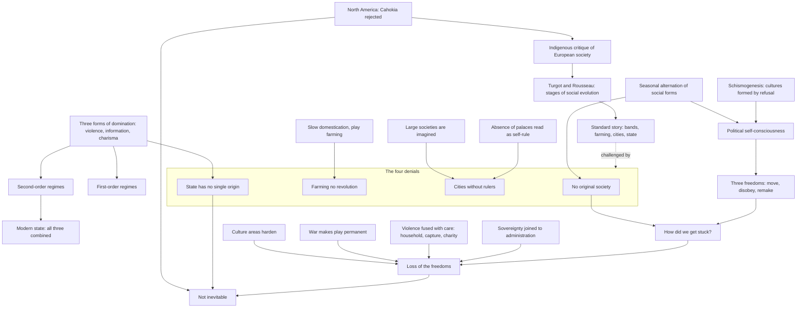

# Synthesis: The Dawn of Everything

Reading purpose: "Understand and critically evaluate the book's argument in full, and leave notes solid enough to support later cross-book thematic syntheses." The reader did not state a purpose; this one is inferred from how this repository is used. Section 4 should be rewritten if the real purpose differs.

Page numbers are `[[page N]]` markers in this workspace's `source.txt` (500-word synthetic pages, not printed pages). Unit notes are in `notes/`; the ledger of terms is `terms.md`. The endnotes are missing from this text and were not read, so where the authors' support for a claim sits in a note, this synthesis can report only what the main text says.

## 1. What is the book about as a whole?

The book sets out to replace the standard large-scale story of human history. That story, in the version the authors attribute to Rousseau, runs from small egalitarian bands of foragers through an Agricultural Revolution to cities, states and inequality; in the version they attribute to Hobbes, it runs from a violent beginning to order imposed by states (pp. 7-8). The authors hold that both versions are untrue, have bad political effects, and make the past dull (p. 8).

Their replacement has a negative half and a positive half. The negative half is a series of denials: there was no original form of human society (p. 67); farming was not a revolution and did not bring property and rank in its train (pp. 178-179, 188); cities did not require rulers (pp. 213, 242); and "the state" has no single origin because it is three different things that happened to combine (pp. 274-275, 323). The positive half is a claim about what humans were doing instead: moving between different social arrangements, often by season, and doing so knowingly (pp. 89, 376). From that follows the book's own question, which replaces the question about the origin of inequality: how did people become stuck in one arrangement (p. 92)?

It is also a book about where the standard story came from. The second chapter and the eleventh argue that the idea of stages of social evolution was devised in eighteenth-century Europe in reply to criticisms of European society made by Native Americans, and that those criticisms came out of a long indigenous political history (pp. 51, 360-361). This gives the book its shape: it begins and ends with the Wendat statesman Kandiaronk.

The authors describe what they are doing as a synthesis of work by specialists who seldom compare notes (p. 9), and as a search for better questions as much as for answers (p. 25). They say they did not weigh rival interpretations case by case (p. 386). The book should be read as an argument for a way of seeing the evidence, by two authors who say openly that they have set the dial between freedom and determinism towards freedom as a matter of taste (p. 158).

## 2. What is said in detail, and how?

### The main line

1. **The question is the wrong one (ch01, ch02).** To ask for the origin of inequality is to assume an original equality and a fall (p. 13). The word inequality invites technocratic adjustment and hides what people object to, that wealth becomes power over others (p. 11). "Egalitarian" has no stable meaning; it names what is left when the marks of civilization are taken away (p. 62).
2. **Where the question came from (ch02).** Seventeenth-century French missionaries recorded indigenous Americans criticising French society for its lack of freedom and mutual aid, and both sides agreed that the Americans were free and the French were not (p. 36). Lahontan's Dialogues of 1703 carried arguments the authors attribute in substance to Kandiaronk (pp. 44-45), and were widely imitated (p. 50). Turgot answered by making freedom and equality the marks of poverty and arranging societies in stages by how they get food (p. 51). Rousseau fused the critique with the stages and lost the sense that things could be otherwise (pp. 55-56).
3. **The Palaeolithic record (ch03).** Rich burials and monumental building appear tens of thousands of years before farming (pp. 71-74), but sporadically and without the apparatus of rule (p. 74). Most of the richly buried were physically anomalous (p. 82). The sites belong to societies that gathered and dispersed with the seasons (p. 84), and ethnography shows such societies changing their political form with the season, including temporary police with real coercive power (pp. 86-88). The authors infer that early humans built hierarchies and took them down again (p. 89).
4. **After the Ice Age (ch04, ch05).** Foragers built at Poverty Point on the scale of an early city (pp. 111-112) and, among the Calusa, sustained a kingdom on fish (pp. 118-119). What "egalitarian" societies valued was freedom, with mutual aid as its condition (pp. 103-104). Social worlds shrank and hardened into culture areas (pp. 97-99). Cultures form by refusing what their neighbours do (p. 134); the Northwest Coast and California are the worked case, with slavery on one side and its rejection on the other (pp. 136, 159).
5. **Farming (ch06, ch07).** In the Fertile Crescent about 3,000 years passed between the cultivation of wild cereals and their domestication, ten times what was biologically necessary (p. 178). Early cultivation on flood-retreat soils did not lend itself to fixed fields (p. 179). The groups least dependent on farming show the clearest signs of rank and violence (p. 189). Elsewhere farming spread unevenly, was sometimes dropped, and in central Europe collapsed after a boom (pp. 192, 197-198).
6. **Cities (ch08, ch09).** Large societies are always partly imagined, among foragers as among townspeople (pp. 208, 211), so size posed no new cognitive problem (p. 212). The Ukrainian mega-sites, early Uruk, the Indus cities and Teotihuacan show no palaces or royal imagery (pp. 219, 224, 239, 248). Aristocracy appears first on the edges of the Mesopotamian urban world (pp. 233-235). At Taosi and Teotihuacan an elite order seems to have been overturned (pp. 245, 254-255). Tlaxcala was governed by a council that debated its alliance with Cortés (pp. 263-264).
7. **The state (ch10).** Social power rests on control of violence, control of information, or charisma (p. 272); their institutional forms are sovereignty, bureaucracy and competitive politics (pp. 273-274). Some polities developed one of the three (p. 292), the classic early states fused two (p. 310), and the modern state joins all three (p. 323). Sovereignty alone reaches only as far as the ruler's presence (p. 294). Bureaucratic technique appears first in small egalitarian villages and may have been designed to keep people equal (pp. 315-317); joined to sovereignty it turns impersonal equivalence into a means of extraction (pp. 318-319).
8. **The test of inevitability (ch11).** The Americas before 1492 are the one independent comparison (p. 338). Cahokia rose as something like a grain state and was abandoned, its region left empty (pp. 339, 350); its successor kingdoms gave way to council-governed republics (p. 353). The Osage and Haudenosaunee remembered their institutions as deliberate constructions against arbitrary power (pp. 359, 363).
9. **The conclusion (ch12).** Three freedoms were once assumed: to move away, to disobey, and to create or change social arrangements, the first two supporting the third (p. 376). Their loss is traced, tentatively, to the hardening of cultural boundaries (pp. 377-378), to violence making play permanent (p. 378), and above all to the fusion of violence and care in the patriarchal household and the court modelled on it (pp. 382, 385). Following Steiner, command may have begun in charity towards the unattached (p. 390).

### The tools doing the work

Four devices recur and carry more of the argument than any single case.

- **Seasonality.** The claim that people lived under different regimes at different times of year (pp. 86-89) is what turns scattered evidence of both hierarchy and equality into evidence of choice. It reappears at Çatalhöyük (p. 171), in play farming (p. 196), and in the suggestion that early kingdoms were seasonal (p. 321).
- **Schismogenesis.** Self-definition against a neighbour (p. 48) explains California against the Northwest Coast (p. 139), lowland against upland Neolithic (pp. 186-187), heroic societies against cities (p. 235), and Teotihuacan against the Maya (p. 249). It lets the authors treat cultural difference as political decision.
- **The evidential asymmetry.** Royal rule leaves unmistakable traces when it exists (pp. 224, 230, 247), so its absence from a large site is taken as evidence of self-government. The authors add that scholars demand proof of ancient democracy and none of ancient hierarchy (p. 240).
- **Ethnographic analogy.** Recent peoples are said not to be windows on the past (p. 82) but to show what is possible (p. 96). In practice the Nambikwara, Plains nations, Basque villages, Bali, the Natchez and the Shilluk supply the mechanisms for cases where archaeology supplies only layouts.

### What the authors concede

The concessions are scattered and easy to miss. Gathered, they qualify the headline claims considerably.

- Much of the reading of Palaeolithic burials is speculation (p. 83).
- Environment and technology often make a huge difference; how much agency matters cannot be known (pp. 157-158).
- Geography does shape the spread of crops (p. 193), and farming had explosive growth potential (p. 207).
- Cereal farming made bureaucratic states possible (p. 101) and is predisposed to their fiscal needs (p. 333).
- In the very long run history did move in an authoritarian direction (p. 243), and for at least 2,000 years most people have lived under kings or emperors (p. 332).
- Egypt, and later the Inca, do fit the conventional model of state formation (p. 314).
- Not all first cities were egalitarian (p. 242); the evidence for early Mesopotamian self-rule depends heavily on one site (p. 228); for the Indus the authors have no way of knowing (p. 241).
- The stranger-king account of Teotihuacan's presence among the Maya is guesswork (p. 252), and how Tlaxcala's officials were chosen is unknown (p. 265).
- How we got stuck must remain partly a matter of speculation (p. 377).

## 3. Is it true, in whole or in part?

### What holds

- **The long delay in domestication.** This is the best-evidenced claim in the book. It rests on experimental work and on archaeobotanical samples in the tens of thousands (pp. 176-178), and it does show that the beginning of farming in the Fertile Crescent was not a rapid switch. I judge this sound as reported.
- **Monumental building and rich burial before farming.** Göbekli Tepe, the mammoth structures, Poverty Point and the Jōmon and northern European sites (pp. 72-74, 111-115) establish that large coordinated works do not presuppose agriculture. The authors' reading of the politics behind them is another matter, but the negative point stands.
- **Hierarchy without farming and without a state.** The Calusa (pp. 118-119), the Northwest Coast (pp. 140-143) and the Natchez (pp. 293-294) show kingship, rank and slavery in societies that fit none of the stage definitions.
- **The incoherence of the stage sequence for cases that alternate.** If the same people were band-like in one season and state-like in another (pp. 87-88), a ladder from band to state cannot describe them. The argument is a reductio and it works against any strict version of the sequence.
- **Bureaucratic devices in a small village.** Tell Sabi Abyad (pp. 315-316) is a clear counter-example to the claim that administration arises from scale.
- **The critique of period labels.** That "intermediate" and "post-classic" carry a judgment (pp. 283-284) is well made, and the dating of the Egyptian tripartite scheme to the late nineteenth century is a checkable historical claim.

### Where the authors overreach

- **From seasonal gathering to seasonal politics.** The archaeology shows that Ice Age people congregated and dispersed (p. 84). That their political order alternated with it is carried by analogy with the Inuit, Kwakiutl and Plains nations (pp. 86-88), which the authors elsewhere say cannot be a window on the past (p. 82). The conclusion that humans spent most of 40,000 years assembling and dismantling hierarchies (p. 89) is stronger than this supports. It is a reasonable hypothesis presented as a finding.
- **From absence of palaces to presence of democracy.** For the mega-sites the authors write of "proof that highly egalitarian organization has been possible on an urban scale" (p. 223). What is shown is the absence of central buildings, storage and elite burials over eight centuries, plus a Basque analogy. That is good evidence that rule by a visible elite was not required. It is not evidence of how decisions were made. The same gap separates "no palace at Tlaxcala" from "democratic credentials" (p. 267), where a council of perhaps 50 to 200 in a population of 150,000 (pp. 259, 265) would fit an oligarchy equally well.
- **The causal claim about social evolutionism.** That Turgot's stages followed the vogue for Lahontan and answered a novel in that tradition is shown (pp. 50-51). That the theory arose "as a direct response to the power of indigenous critique" (p. 51) is asserted; the text itself says Turgot had been arguing for the primacy of technological progress for some years (p. 51).
- **Exhaustiveness of the three forms of domination.** The thought experiment (pp. 271-272) shows three ways of securing exclusive possession. It does not show there are only three. Control over the means of subsistence is folded into the threat of violence without argument (p. 271).
- **Schismogenesis as explanation.** In each case the pattern of opposition is documented and the deliberateness is inferred. For the Fertile Crescent the authors grant that coincidence or environment could account for it and that the lowland skull tradition predates the contrast it is supposed to answer (pp. 186-187). For the Pacific Coast the model Californians, the Yurok, are by the authors' account atypical: they held some slaves, inherited wealth and had debt peons (p. 156).

### Where the authors are incomplete

- **The answer to the book's own question.** The question of how we got stuck is posed early (p. 92) and answered late (pp. 377-390) with suggestions the authors label as preliminary. War and patriarchy do most of the explanatory work and neither is given an origin; the authors say the evidence is only beginning to be assembled (p. 391). Steiner's mechanism explains what follows once refuge is no longer freely available, not why it ceased to be.
- **The long-run pattern.** The book establishes that domination was not immediate, not universal and sometimes reversed. It grants that it nonetheless became nearly universal in Eurasia (pp. 243, 332). No account is offered of why the reversals stopped succeeding, beyond the remark that until about 500 years ago many people could still escape (p. 334).
- **Conditions of exit.** North America is offered as proof that state formation can be undone (p. 360). The same pages say that populations there were sparse and empty land plentiful (pp. 351, 353). Whether exit was available in the Nile valley or the Mesopotamian plain, where it was not undone, is not discussed.
- **Demography.** The sceptic's point that agriculture alone fed the growth from millions to billions is stated (p. 206) and not answered.
- **Competing interpretations.** By the authors' choice (p. 386) the reader is not told where a reading is the specialist consensus and where it is contested, except in a few flagged cases (Clark's measurement system, p. 113; Taosi, p. 245; Tsouharissen, p. 366).

### What I cannot verify

- Any claim whose support is in the endnotes, which this text lacks. This includes the frequency with which captives chose to stay with indigenous societies (p. 20), the proportion of anomalous individuals among rich burials (p. 82), the absence of the vocabulary of equality from medieval sources and from the Jesuit Relations (pp. 29, 36), and the estimate that a quarter of the Northwest Coast population was enslaved (p. 142).
- Whether the archaeological summaries represent the current state of each field. The text reports them with confidence; I have only the text.
- The authenticity of Lahontan's Dialogues as a record of Kandiaronk. The authors' case is circumstantial (p. 44) and they state the grounds for doubt themselves (pp. 43-44).
- Whether Montesquieu met the Osage delegation of 1725. The authors say they do not know whom the delegates met (p. 360).

### The inevitability dispute

The claim that matters most to the authors is that present arrangements were not inevitable (p. 323) and that the worst institutions "never had to happen" (p. 393). Two things should be kept apart. That the sequence foraging, farming, city, state is not a law, in the sense that each step did not automatically bring the next, is well supported by the delays, reversals and exceptions the book collects. That the eventual outcome could have been avoided is a different kind of claim, and the authors themselves say that questions about what might have happened cannot be definitively answered (p. 337) and that the weight given to agency is a matter of taste (p. 158). The book earns the first claim. The second is a stance the first makes permissible; it is not a finding.

## 4. What of it?

Against the purpose of building notes for cross-book work, six things are worth carrying forward.

1. **A vocabulary that travels.** The three freedoms (p. 376) and the three forms of domination (p. 272) can be applied to other books without accepting this book's history. Hayek's freedom from coercion, in The Road to Serfdom, is close to the second freedom alone; Graeber and Wengrow's insistence that freedom needs mutual aid behind it (pp. 42, 103-104) is the opposite of Hayek's view that security beyond a minimum threatens freedom. Scott's legibility, in Seeing Like a State, is the second form of domination in the service of the first; this book's account of accounting devices turned from equalising to extracting (pp. 317-319) is the same thought with a prehistory attached, and it cites Scott directly on grain (p. 333).
2. **A different question for inequality.** Piketty's Capital in the Twenty-First Century is exactly the kind of work the first chapter has in view: measurement of distributions, remedies through taxation (p. 11). The useful confrontation is not over facts but over whether the distribution of wealth or the conversion of wealth into command is the thing to study (pp. 45, 55).
3. **A warning about evidence from absence.** The book's method depends on reading the lack of palaces as self-rule. Any theme that draws on its city cases should carry the qualification that the cases differ greatly in strength: Tell Sabi Abyad and the domestication delay are strong; the mega-sites and Teotihuacan are strong on the absence of rulers and silent on what replaced them; the Indus and Minoan readings are admissible and unproven.
4. **The care and violence thesis.** The idea that durable domination grows out of household relations of care, by way of capture, charity and patriarchy (pp. 147, 159, 385, 390), is the book's most original proposal and its least developed. It is the place to look for connections to histories of slavery, the family and welfare.
5. **Play, ritual and experiment.** The claim that institutions and techniques are tried first in ritual or play (pp. 374-375) and that seasonal variation kept political imagination alive (p. 93) is a hypothesis about how social change happens that can be tested against other periods.
6. **What the book does not settle.** It shows that the old sequence is not a law. It does not explain why hierarchy nonetheless won, and says so (p. 377). A theme on the origins of states or of inequality should treat this book as clearing ground and as a source of counter-examples, and should look elsewhere, including to the authors' own acknowledged interlocutor Scott, for the mechanics of how escape was closed off.

## Concept map

*(hand-authored from `terms.md` and the chapter notes. The edge from North America back to the indigenous critique is the book's "full circle": the critique that prompted the standard story is itself the product of a history the standard story cannot describe.)*

## Verification log

Mechanical check: `verify-quotes.sh` — 147 checked, 147 ok, 0 near, 0 fail. An earlier run reported 8 fail and 1 near, all in the notes. Each was a quotation that the checker had paired with a later page cite in the same sentence, or a phrase of my own placed in quotation marks; the sentences were reordered so each quote is followed directly by its own page, and non-quotations lost their quotation marks. One citation was a genuine page error (a Minoan quotation placed on p. 327 that sits on p. 328) and was corrected.

Hand-verified paraphrased claims, by re-opening the cited pages in `source.txt`:

- ✓ verified — Cultivation of wild cereals in northern Syria from at least 10,000 BC, domestication complete only towards 7000 BC, described as about ten times longer than necessary (p. 178) — the passage gives both dates and the comparison.
- ✓ verified — Experiments showing domestication achievable in twenty to thirty years, at most 200 (p. 176) — stated in those terms.
- ✓ verified — Both sides in the Jesuit exchanges agreed that Americans were free and Europeans were not, and differed on whether liberty was desirable (p. 36) — stated directly.
- ✓ verified — Turgot had been arguing for the primacy of technological progress before the lectures that set out the stages (p. 51) — the text says he had been arguing this for some years.
- ✓ verified — Most rich Upper Palaeolithic burials show physical anomalies (p. 82), and most other dead were not buried (p. 83) — both stated; the first is given as "a majority" without figures.
- ✓ verified — The three bases of power derived from the necklace thought experiment (pp. 271-272) — the three steps are as summarised.
- ✓ verified — First-order regimes defined on p. 292 and second-order regimes on p. 310, with Egypt, Mesopotamia and the Maya assigned to different pairs — as summarised.
- ✓ verified — The concession that history moved in an authoritarian direction in the very long run (p. 243) — present, with the qualification that civic institutions never entirely disappeared.
- ✓ verified — The final statement of the three freedoms and the scaffolding relation (p. 376) — as summarised.
- ✓ verified — The authors' statement that how we got stuck must remain to some degree a matter for speculation (p. 377) — present.
