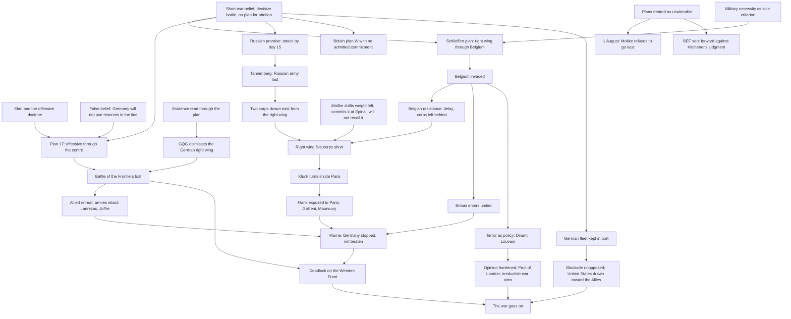

# Synthesis: The Guns of August

Reading purpose: "What does Tuchman argue about why the war opened as it did and why its first month fixed its shape (plans, people, miscalculation), and how good is her evidence?"

## Status

Written from the notes for every unit of the text: front matter, chapters 1 to 22 and the Afterword. Limits, set out in `map.md`: chapters 11 and 12 were noted by a delegated reader; chapters 15 to 22 were read out of order; the endnotes and source list (pp. 370–410) were sampled and tallied by script, not read, so judgments about sourcing rest on what the text itself attributes plus that tally. A first version of this file was written when chapters 15 to 22 were still unread; this version replaces it.

## 1. What is the book about as a whole?

It is a narrative history of the opening of the First World War on the Western and East Prussian fronts and at sea, from the plans laid before 1914 to the eve of the Marne on 5 September, with an Afterword on what the Marne decided. Tuchman chose the first month because, as she puts it, it contained all the roots (p. 9). She leaves out Austria-Hungary, Serbia and the Balkans on purpose (p. 12), and gives the July crisis one paragraph (pp. 67-68). The battle of the Marne itself is one paragraph of the Afterword (p. 365).

The book has a thesis, which she accepts in the Preface in Clifton Fadiman's words (pp. 9-10) and states herself in the Afterword: the failures of the first month produced a deadlock, and the deadlock set the course of the war and of what followed (p. 368). The Marne mattered because it determined that the war would go on (p. 369).

## 2. What is said in detail, and how?

The argument is carried by narrative in three parts (Plans, Outbreak, Battle) and can be laid out as seven linked claims.

**a. Every power had a plan, and every plan rested on a false assumption about someone else.** Germany's plan required Belgium and assumed Belgium would not fight and that Britain would not matter in a short war (pp. 28-31, 106). France's Plan 17 assumed Germany could not be strong on its right and in its centre at once, because it would not put reserves in the line (pp. 40-41, 46-47). Britain had a detailed plan to fight beside France and a government that denied being committed (pp. 54-55, 87). Russia promised an offensive by the fifteenth day that its railways and munitions could not support (p. 58).

**b. All of them planned for a short war of decisive battle, including the men who expected a long one.** Both Moltkes and Joffre foresaw a long struggle and made no provision for it; only Kitchener acted on the belief (pp. 29-30, 107). The same belief idled the German fleet (p. 279) and made Moltke refuse an economic staff (p. 282).

**c. When the crisis came, the plans governed the men.** On 1 August the Kaiser ordered the army east and Moltke told him it could not be done; she shows that it could have been (pp. 73-74). The German note to Belgium was drafted on 26 July (pp. 91-92). The British accepted a concentration plan Kitchener thought wrong because the troops were already moving (ch12 note). Russia kept a timetable its own war games had shown to be faulty (pp. 228-229). Her general statement is that the impetus of existing plans is stronger than the impulse to change (pp. 142-143).

**d. In the field, evidence that contradicted the plan was explained away, and the offensives failed.** GQG treated every report of German strength west of the Meuse as good news (pp. 177-180, 190). The French attacked in Lorraine and the Ardennes without heavy guns, reconnaissance or entrenchment and lost more than 140,000 men in four days (pp. 197, 200-201, 220). Russia attacked before its supply was ready, broadcast its orders uncoded, and lost an army at Tannenberg (pp. 225, 245, 257).

**e. The German right wing was whittled down until it could not do what the plan required.** Moltke had shifted strength leftward before the war (p. 33). In August he let the left wing attack (p. 184), committed it against the French fortresses (p. 199), and would not withdraw it even when his own envoy advised it and the Kaiser objected (pp. 335, 353-354). Two corps went to East Prussia when OHL, alarmed by reports already out of date, believed the West was won (pp. 237-238, 247-248). By 28 August the right was five corps short (p. 307). Kluck, short of men and convinced the French were beaten, turned inside Paris (pp. 334-336).

**f. The Allies survived because some men departed from the plan and one man kept the armies together.** Lanrezac retreated without orders at Charleroi (pp. 214-215); Smith-Dorrien stood at Le Cateau against orders (p. 301); Castelnau and Dubail held the Moselle (p. 308); Gallieni saw the exposed flank and forced the date (pp. 347, 354-355, 360); Franchet d'Esperey supplied a workable plan in a quarter of an hour (pp. 358-359). Joffre, blamed for the plan, is credited with the calm that kept a beaten army from dissolving and with the decision to fight (pp. 321, 358-359, 367). The British commander nearly left the line and was held in it by Kitchener and then by Joffre (pp. 329-332, 364).

**g. The result was a battle that stopped Germany without defeating it, in a war that could no longer be ended by agreement.** The Afterword lists the ifs: the corps sent east, the overcommitted left, the exhausted right, Kluck's position, and first of all the march through Belgium (p. 366). Plan 17's failure left the Germans deep in France and the Schlieffen plan's failure left them unable to finish; together they made the Western Front (p. 368). Chapter 17 supplies the other half: German terror in Belgium, meant to shorten the war, turned opinion; the Allies bound themselves against a separate peace; and each side adopted aims the other could not accept (pp. 263, 270-272). Chapter 18 adds blockade and the first pull on the United States (pp. 281-285).

How she argues: by scene and character. Each plan is introduced through its author (Schlieffen, Foch and Grandmaison, Wilson, Sukhomlinov). Causal claims are usually made in a sentence at the end of a scene. Three devices recur: the overruled prophet (Michel, pp. 39-42; Lanrezac, pp. 177-178, 350-351; Kitchener, ch12), the disobedient subordinate who is right (François, pp. 231-232, 254; Smith-Dorrien, p. 301; Lanrezac, p. 215), and the counterfactual (pp. 76, 218, 275, 362, 366).

## 3. Is it true, in whole or in part?

Three verdicts, kept apart.

**Well supported.**
- That the German plan was treated as unalterable when it was not. She cites the standing eastern deployment plan, von Staab's later demonstration and Moltke's own admission to Erzberger (p. 74).
- That Plan 17 rested on a false count of German strength, and that the evidence against it was available beforehand: the 1904 betrayal, the 1913 intelligence, the reserve corps found on 24 August (pp. 46-47, 222).
- That German reprisals in Belgium were policy and were announced as such. The proclamations were printed in advance; Bülow's placards and the Berlin statement on Louvain say what was done and why; the army commanders describe the measures in their own memoirs; the witnesses at Louvain were neutral Americans (pp. 192-193, 263-264, 268-270). This is the best-evidenced part of the book.
- That the right wing was depleted. The count of corps detached is assembled from German accounts and matches Tappen's and Moltke's own words (pp. 247-248, 307, 334, 353-354).
- That Britain was committed in fact while free in form (pp. 54-55, 87), and that Sir John French meant to withdraw from the line: his own letters and telegrams are quoted (pp. 329, 331).

**Incomplete, or claimed beyond the evidence shown.**
- National character as explanation. The German plan is attributed to a century of philosophy (p. 29), reprisals to a German need for order (p. 267), and German opinion is drawn largely from Bernhardi, the Kaiser, slogans and café talk (pp. 17-18, 21-22, 261-262). A sufficient military and institutional explanation sits beside each of these.
- That schedules dragged all the governments forward (p. 68). This is shown for Germany only. Leaving out Austria and Serbia (p. 12) removes the place where the war began and most of the question of who chose it.
- Rigid plan or unfaithful successor. She faults the German plan for rigidity (p. 33), Moltke for departing from it (pp. 182, 199, 335), and shows a German commander using wide latitude and erring (p. 336). These are three different diagnoses. She also notes that Schlieffen himself lacked the divisions for his design (p. 28) and does not follow that through.
- The Marne counterfactuals. Each if is plausible alone; the Afterword stacks five (p. 366) and the chapters add more (pp. 213, 218, 362). They cannot all be decisive. On the two corps sent east, Ludendorff said they were not needed (p. 247), which supports her point that the transfer was an error and leaves open whether two corps would have changed the battle.
- Joffre and Gallieni. She gives both versions and says the record was fought over and partly expunged (pp. 340-341, 363). Her division of credit is reasonable and cannot be checked from this book.
- Long chains from single events: the Goeben to the fall of the Ottoman Empire (pp. 137-138), though Turkey had already signed with Germany (p. 121); the Order in Council to American entry (pp. 281-282, 287); the deadlock to the peace and the next war (p. 368). Each is stated in a sentence or two.
- The Briey ore claims (pp. 107, 205) and the weight of the phantom Russians on German decisions (pp. 328-329) are asserted in passing.
- Allied conduct gets lighter scrutiny. Britain's bending of maritime law for a military reason is described without the judgment applied to German necessity (p. 281), and Allied war aims get a paragraph beside a page on the German ones (p. 272).

**Sources and bias.** She says herself that the participants' accounts are a forest of special pleading (p. 370) and that most of the commanders of August wrote private justifications. The book is built on those accounts. The scene of 1 August rests on Moltke's memoir (pp. 73-76); British planning on Henry Wilson's diary (pp. 52-54); Russia on émigré ministers and the French ambassador (pp. 59-62); Belgium on the King's circle (pp. 91-97); Tannenberg on three rival German memoirists and a British observer (pp. 245-247, 258-259); the navy on Tirpitz (p. 276). For the French command the tally of endnotes shows Joffre's own memoirs as the most-cited source in the Marne chapters, alongside his critics (Lanrezac, Messimy, Gallieni, Spears), so the picture of GQG does not rest on critics alone; she warns that those memoirs were staff-written and semi-official (p. 200). She often flags a doubtful witness in the text: an apocryphal proposal (p. 71), an embroidered scene (p. 77), Fisher's letters (p. 125), Hoffmann's malice (pp. 235-236), French's unreliable version of a meeting (p. 332). She does not correct for the bias systematically, and the overruled prophets are heard mostly in their own words. She admits needing help with German (pp. 11-12).

**Cannot verify from this reading.**
- How she uses the endnoted sources passage by passage; the notes were not read.
- Chapter 12's claims, which I took from a delegated note.
- How historians have judged the book's accuracy. Massie mentions the popular-history label and nothing else (p. 6). A second history of the same events is the proper check, above all for July 1914, the Schlieffen plan and the Belgian atrocities, where the book's framing is strongest.

## 4. What of it?

Against the reading purpose:

- **Why the war opened as it did.** Her answer is that the opening was set before 1914 by plans that had to be executed whole and at once. The strongest part of the book is the pairing of ch02 and ch03 with ch06 and ch14: the assumptions are laid out, then shown failing.
- **Why the first month fixed the war's shape.** Two arguments, of which the Afterword states only the first. Militarily, both sides staked everything on a decisive battle and neither got one, for reasons the narrative traces to detachments, delays and command decisions (ch16, ch19, ch21, ch22). Politically, the conduct of the invasion and the aims adopted in its first weeks removed the possibility of stopping (ch17, ch18). The second argument is the better evidenced and the less noticed.
- **How good the evidence is.** Good on plans, orders, dated documents and German conduct in Belgium; dependent on interested memoirs for motive and for who warned whom; weakest where she explains by national character or reaches past August. Her habit of flagging doubtful sources in the text is a real strength.
- **What transfers.** The reusable ideas are about institutions under commitment: a plan that cannot be changed becomes policy (pp. 73-74); a staff reads evidence through what it wants to do (pp. 47, 207); being right and overruled is not forgiven (pp. 42, 350-351); undeclared commitments bind anyway (p. 87); coercion meant to shorten a conflict can lengthen it (pp. 263, 270); confidence can blind as well as steady (pp. 321, 353). These are her interpretations, illustrated by cases, and should be cited as such.
- **Next step for this workspace.** Read the endnotes for the chapters that carry the most weight (2, 3, 6, 14, 17, 21, 22), re-read chapters 11 and 12 directly, and pair the book with a later history of 1914 for a syntopical check.

## Concept map

Drawn from `terms.md` and the chapter notes.

## Verification log

Mechanical check: `verify-quotes.sh` — 152 checked, 152 ok, 0 near, 0 fail, 0 skipped → nothing to fix. All checked quotations are in the twenty-five notes; this file, `map.md` and `terms.md` contain no quoted run of five or more words. The checker skips quotations shorter than five words; five such short quotes in the notes were confirmed by direct search of the text. The checker covers quotations only and says nothing about paraphrase.

Hand-verified paraphrased claims. Each was checked against the chapter text as read for the notes; none was re-opened a second time after the note was written unless marked.

- ✓ verified — the plan could have been altered: a standing eastern plan, Staab's demonstration, Moltke's admission to Erzberger (p. 74) — read in full for the ch06 note.
- ✓ verified — the Belgian ultimatum was first drafted by Moltke on 26 July (pp. 91-92) — read in full for the ch08 note.
- ✓ verified — French intelligence had evidence of German use of reserves in 1913 and the Staff rejected it (p. 47) — read in full for the ch03 note.
- ✓ verified — German strength west of the Meuse was 30 divisions against GQG's estimate of 17 or 18 (pp. 207-208) — read in full for the ch14 note.
- ✓ verified — two corps and a cavalry division left the Western Front on 26 August; Ludendorff had said they were not positively needed (pp. 247-248) — read in full for the ch16 note.
- ✓ verified — the right wing was five corps short by 28 August (p. 307) — read in full for the ch19 note.
- ✓ verified — Moltke's halt order of 4 September and Joffre's Order No. 6, signed two hours apart (pp. 354, 360-361) — read in full for the ch22 note.
- ✓ verified — Louvain was announced by German authorities as punishment by destruction (pp. 268-270) — read in full for the ch17 note.
- ✓ verified, re-read — the Afterword names Belgium as the first and decisive if and the deadlock as determining the course of the war, the peace terms, the inter-war period and the Second Round (pp. 366, 368).
- ✓ verified, re-read — her remark on sources as special pleading (p. 370).
- Not verified by me — ch12 claims, and the second half of ch11. Those notes were written by a subagent, which reported checking its quotes against `source.txt`; its quotes also pass the mechanical check.
- Not verified — any claim about what the endnotes contain beyond the name tally.
