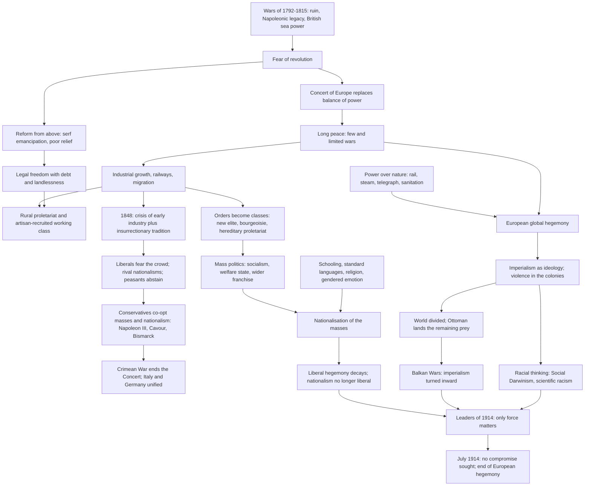

# Synthesis: The Pursuit of Power: Europe, 1815-1914

Reading purpose: "build a reusable, source-anchored account of what Evans argues about nineteenth-century Europe, how the argument is built, and what evidence carries it". No reader supplied a purpose, so this default was used.

Written from the ten notes in `notes/` and from `terms.md`, not from the book. Page numbers are `[[page N]]` markers in this workspace's `source.txt`. A cite such as (pp. 216–217) on a single sentence means the paragraph holding it runs across a page break.

## 1. What is the book about as a whole?

It is a history of Europe between Waterloo and the outbreak of the First World War, written as a transnational synthesis for the general reader. Evans justifies the period by one fact: these were the years of European global hegemony (p. 5). He denies himself a master-narrative of the kind Hobsbawm built on capitalism and says the most a historian can now do is trace lines of development: the growth of the state, the widening of the public sphere, faster communications and economic growth (p. 7). He then supplies a common thread anyway. Every movement of the century, from aristocratic paternalists to anarchists, wanted power in order to act on its answer to inequality, and states, armies, parties, businessmen, unions, feminists, scientists and engineers each pursued power in their own field (p. 9). Power displaced glory and honour as the governing value, and by the end of the century was being reconceived in racial terms (pp. 9–10).

The book has two counterweights to any story of progress. Emancipation, of serfs, women and Jews, was real but only ever partial and conditional (p. 8). And the same advance that produced railways and vaccines produced machine guns, aerial bombing and colonial concentration camps (p. 8). The book ends where that second counterweight lands: with the war that ended European hegemony, and with Grey's remark about the lamps going out (pp. 647–648).

The plan is eight long chapters. Four are political narrative (ch01 1815 to the aftershocks of 1830, ch03 from early socialism through 1848 to 1871, ch07 1871 to 1914, ch08 empire and the road to war). Two are social and economic (ch02 to about 1848, with serf emancipation followed to 1914; ch04 from mid-century). Two are cultural and range over the whole period (ch05 on control of nature and of human nature, ch06 on feeling, religion, language, gender and the arts) (p. 10). Each opens with one person's life, four men and four women from eight countries (p. 10).

## 2. What is said in detail, and how?

The book mostly narrates. Its arguments sit in the Preface and in the opening and closing paragraphs of sections. Read across the notes, they form one chain.

**The peace of 1815 was built on fear of revolution, and it held.** The Revolutionary and Napoleonic wars killed an estimated five million people (pp. 15–16) and left an administrative and legal legacy that could not be reversed (p. 26). The shift of the global balance towards Europe came out of those wars and British command of the seas, not out of a long-run European superiority (pp. 28–30). After 1815 Europe had few wars and limited ones; Evans gives the death rate of men in battle as seven times lower than in the previous century (pp. 35–36). The explanation he prefers is that the Great Powers gave up balance-of-power doctrine for a network of collaborative institutions, the Concert of Europe, and that what lay behind their co-operation was fear of revolution (p. 36). Sovereignty passed from dynasties to states (pp. 36–37). The conspiracies governments feared were feeble (p. 52). The revolutions of 1830 destroyed absolutism in the west but not monarchy, because the middle classes feared the crowd (pp. 85–86), and the peasantry was almost wholly absent (p. 87).

**The social old regime ended later, by reform from above, and each freedom brought a new dependence.** Serf emancipation was in principle the greatest single act of reform of the century (pp. 98–99), pressed above all by the serfs' own resistance (pp. 94–95) and granted partly to win peasant loyalty against liberals (p. 96). In practice landowners were compensated, small peasants fell into debt, and a landless class with only its labour to sell grew (pp. 100–102). The typical European for most of the century was a peasant (pp. 111–112). The hungry forties were the last great subsistence crisis; in Ireland about a million died, and Evans puts the difference from Belgium and Scotland down to policy and attitudes (pp. 123–125). Britain's industrial lead is credited to world trade and empire (pp. 129–130), steam is called the decisive breakthrough (p. 136), and on the Continent railways came before industry (pp. 147–148). The first working class was recruited from impoverished artisans, not peasants (pp. 155–160). The framing of this chapter as a set of paradoxes is the note-taker's reading; the chapter never explains its title (see `notes/ch02-the-paradoxes-of-freedom.md`).

**1848 is the hinge, and 1848 to 1871 is one period.** Early nationalism was mostly a means to liberal reform (pp. 170–171). The crisis of the late 1840s joined harvest failure to a crisis of early industry, rulers' expectation of revolution became self-fulfilling, and for a while French insurrectionism displaced English gradualism (pp. 179–180). The revolutions were European from the start because railways, steamships and literacy spread news and distress together (p. 181). They were not half-hearted failures (pp. 188–189). They broke on three things: liberals' fear of the masses after the June Days and the clash of rival nationalisms (pp. 191–192), the superiority of loyal professional armies (p. 209), and peasant abstention (pp. 209–210). What followed was not a restoration of the Vienna order (pp. 216–217). A new generation of conservatives, Cavour, Bismarck, Napoleon III and Disraeli, co-opted the masses and exploited nationalism (pp. 216–217). The Crimean War ended the Concert and monarchical solidarity (pp. 224–225). Evans proposes treating 1848 to 1871 as a single period of revolutionary change (pp. 246–247).

**Industrial society turned orders into classes.** The growing state, not the bourgeoisie alone, undid the aristocracy by taking over its functions, and Evans rejects the thesis that the old regime persisted to 1914 (p. 260). Nobles became a status group merged with a new elite of wealth (pp. 267–269). Germany overtook Britain in the science-based second industrial revolution (pp. 279–282). The bourgeoisie was essentially a new class (pp. 293–294); the petty bourgeoisie was renewed, against Marx's forecast (p. 301); a permanent, hereditary proletariat formed much as Marx had predicted (pp. 312–313). Class differences could be measured in height and in cholera deaths (pp. 305–306). The separate criminal class was largely a literary conceit, and crime fell as areas urbanised (pp. 314, 318). About 60 million people left Europe (p. 324).

**Power over nature was real, and stopped at human nature.** Rivers were straightened and forests cut back (pp. 338–340). Railways forced standard measures and standard time (pp. 347, 358–361), and rail, steam and telegraph were the technical base of world domination (pp. 348–349). Epidemics retreated because of sanitation, diet and border controls; direct medical intervention did little to prevent and less to cure (pp. 369–370). Death rates fell sharply in the north-west and much less in Russia and Spain (p. 371). Where the object was human nature the record is failure: asylums grew out of changing social mores and became dumping grounds for the deviant (pp. 391, 395–396), prison reform came full circle (pp. 403–404), and behind it all was the growing power of the state (p. 404). The chapter's verdict is that the conquest ran up against the limits of the possible (pp. 406–407).

**Culture made the identities that politics later used.** Romanticism made feeling the test of truth (pp. 411–412) and so let religion back into the mainstream (pp. 416–417). The Churches lost the urban masses more than they lost to hostile states (pp. 426–427), yet Europe stayed overwhelmingly religious to 1914 (pp. 428–429). Jewish emancipation is judged a success from the vantage of 1900, with racial antisemitism a warning note (pp. 437, 439). Identity was local before it was national, and schooling and standard languages made it national (pp. 440–442). Cultural stereotypes gave way to racial ones (pp. 446–447). Emotion was gendered, and feminists won ground by arguing from women's difference (pp. 464–465).

**Democracy widened and liberalism shrank.** The welfare state was in essence a response to the left (p. 504), and organised socialism was perhaps the strongest pressure for democratisation (pp. 516–517). Franchise extension owed much to fear of revolution and to conservatives who expected new voters to outflank the liberals (p. 519). The widened vote ended liberal hegemony and mobilised national minorities (p. 521); the Irish Question was where democracy came into conflict with liberalism (p. 525). France and Italy only seemed unstable (pp. 546–547). In Germany and Russia real power stayed with monarch, court and army (pp. 551, 555–556, 565–566). Evans's summary is that the tide of democracy carried the seeds of its own destruction: liberalism outflanked, the masses nationalised, nationalism no longer a liberal force (pp. 566–567).

**Empire was made possible by European peace, and came home through the Balkans.** Overseas expansion before about 1880 was pushed from the periphery by settlers, merchants and officials (p. 583). The economic theories of Hobson, Lenin and Luxemburg are rejected on timing (p. 586). European dominance was not inevitable after 1500; it took hold in the third quarter of the century and was the product of European peace as much as of technology (p. 595). Turning paper colonies into real ones meant violence: the Herero fell from an estimated 85,000 to 15,000 (pp. 596–597), and the Congo's population is given as halved (pp. 604–605). Once the world was divided, powers could gain only from each other or from the Ottomans (p. 610); the Balkan Wars were imperialism turned in towards Europe (p. 631). In July 1914 the blank cheque was most probably the crucial moment, there is no evidence that Germany used the crisis as an excuse for war, and nobody sought compromise because a generation of leaders had learned from empire that only force mattered (pp. 639–640, 645–646). The crowds for war were middle class (p. 646).

**How the argument is carried.** The method is narrative with embedded argument, a cast of contemporaries who speak in quotation, and dense statistics. There are no notes, by series design (p. 11). Evans says his originality lies in the arguments and in the range and juxtaposition of themes (p. 11). The chapter notes record, section by section, where he argues against unnamed historians and where the figures have no stated source.

## 3. Is it true, in whole or in part?

**What holds up on the book's own evidence.**

- The long peace. The contrast in war deaths and the account of Great Power co-operation are stated plainly and the argument is internally consistent across ch01, ch03 and ch08 (pp. 35–36, 224–225, 595, 633). It is also the one place where the book's separate lines join: peace is given as a cause of empire (p. 595).
- Emancipation with limits. The serf chapter gives terms, payments and outcomes country by country (pp. 94–104), so the claim that legal freedom left peasants indebted and short of land is argued, not asserted.
- Sanitation before medicine. The disease-by-disease chronology shows mortality falling before causes were found or cures existed (pp. 363–370).
- The illusion of instability in France and Italy rests on counts of governments and of ministers who served repeatedly (pp. 536, 546–547).

**Incomplete (a gap, not an error).**

- Power as a theme. It is defined so broadly, from steam to patriarchy (p. 9), that it describes more than it explains. Only ch08 uses it causally, in the claim about what empire taught the leaders of 1914 (pp. 645–646), and there Evans documents the racial theorists and the decisions separately without quoting a decision-maker reasoning that way (ch08 note, Open questions).
- The persistence thesis. It is dismissed in one sentence against unnamed historians (p. 260), while the same chapter reports surviving great estates, protective tariffs and noble hold on local office (pp. 260–265). The Preface names Mayer (p. 3); the chapter does not engage him.
- Why Europe led. The Preface asserts specific historical circumstances without naming them (p. 5); ch01 says the shift came from the wars and sea power and was not a long-run process (pp. 28–29), which the ch01 note finds asserted against unnamed opponents. Britain's industrial lead is credited to empire and trade with domestic factors denied (pp. 129–130), beside the book's own account of coal and steam (p. 136).
- Economics of empire. The Marxist stage theory is rejected on timing (p. 586), but debt, tariffs and profit recur as motives throughout the chapter (pp. 587–588, 593, 602, 614). The rejection is narrower than it reads.
- Counterfactuals offered without support: that 1848 would not have been simultaneous without telegraph and railways (p. 153); that the fall in births shows most people repressing their sexual urges (pp. 383–384); that the beard answers feminism (pp. 459–460); that bourgeois values percolated down to the respectable working class (p. 326).
- Whose voices. The contemporaries quoted are mostly literate, urban and often British; the notes for ch03, ch04 and ch08 each record this.

**Wrong here (internal to the text).**

- The flight to Varennes and the events of July 1789 are attributed to Louis XIV (pp. 69, 186); Louis XVI is given correctly on p. 187.
- Estonian abolition of serfdom is dated 1817 on p. 90 and 1816 on p. 94.
- The annexation of the Transvaal is dated 1877 on p. 581 and 1876 on p. 601.
- Plate caption 5 credits the 1861 emancipation to Alexander I (p. 648).

**I cannot verify this.**

- Every statistic. The book gives no sources, so figures can be checked only against other works. This applies to the headline numbers used above: five million war dead, the sevenfold fall in the battle death rate, a million Irish dead, 60 million emigrants, the Herero and Congo figures.
- The chapter notes list some thirty further apparent slips of date, name or place, flagged by the readers from general knowledge and not checked against a second source or the printed edition. Each note's Open questions section has its list. They should be treated as leads, not findings. Some may be faults of this EPUB.

## 4. What of it?

Against the purpose of a reusable account:

- **Use the book for its connections, not as an authority for facts.** Its value is the juxtaposition Evans claims for it (p. 11): peace and empire, emancipation and new dependence, democracy and the decline of liberalism, mastery of nature and the failure to master human nature. Any single figure or date needs a second source before it is relied on.
- **The argument can be stated without the title's theme.** The chain that survives checking is: fear of revolution produced co-operation among the powers (p. 36); the long peace allowed industrial growth, migration and global dominance (p. 595); 1848 taught conservatives to use nationalism and the vote (pp. 216–217); the widened vote nationalised the masses and weakened liberalism (pp. 566–567); empire supplied the habits and the racial thinking that made compromise unthinkable in 1914 (pp. 645–646). The last link is the weakest.
- **Where to go in the notes.** For the thesis: `notes/fm01-preface.md`. For the hinge: `notes/ch03-the-european-spring.md`. For the ending and the war-guilt position: `notes/ch08-the-wages-of-empire.md`, section "How the book closes". For data-rich comparisons that can be reused once checked: ch02 on emancipation terms and famine mortality, ch04 on class and mortality, ch05 on disease.
- **A second witness is needed.** The history strategy says a single history is one witness. The obvious pairings are the works Evans names as his foils: Osterhammel for the global frame, Hobsbawm for the capitalism narrative he declines, Mayer for the persistence thesis he dismisses, and Bayly and Darwin for the parity claim he borrows (pp. 3–5).
- **For cross-book work.** The book bears on themes of state capacity (ch04, ch05, ch07), the conditions of long peace (ch01, ch08), and emancipation from above (ch02). It stops in August 1914; the series continues with Kershaw (p. 8).

## Concept map

*(hand-authored from terms.md and the chapter notes; the edges are Evans's stated or implied dependencies, and the U and Q edges into X are the least supported)*

## Verification log

Mechanical check: `verify-quotes.sh` — 132 checked, 132 ok, 0 near, 0 fail, 0 skipped. All quotations are in the notes; this synthesis and `terms.md` paraphrase only.

Hand-verified paraphrased claims (the most load-bearing), each re-read in the source:

- ✓ verified — European hegemony is the main justification for the period (p. 5) — the Preface says so in those terms and ties it to the two world wars.
- ✓ verified — all strands shared the desire to acquire and wield power, hence the title (p. 9) — confirmed, with the contrast to Blanning's title.
- ✓ verified — the long peace is explained by the Concert of Europe replacing balance-of-power doctrine, driven by fear of revolution (p. 36) — confirmed; the same paragraph adds that the balance of power still counted, which the summary above keeps.
- ✓ verified — battle death rate seven times lower than in the previous century (pp. 35–36) — Evans does not give a source or specify the denominator.
- ✓ verified — serf emancipation as in principle the greatest single act of reform (pp. 98–99) — confirmed, including the qualifier *in principle*.
- ✓ verified — what was restored in 1850 was not the Vienna order, and new conservatives co-opted the masses (pp. 216–217) — confirmed; the four names are Evans's.
- ✓ verified — 1848 to 1871 as a single period of revolutionary change (pp. 246–247) — confirmed; Evans writes that in many respects it makes sense to see it so.
- ✓ verified — no persistence of the old regime to 1914 (p. 260) — confirmed; the opposing historians are unnamed in the chapter.
- ✓ verified — direct medical intervention did little; sanitation and border controls did more (pp. 369–370) — confirmed.
- ✓ verified — the tide of democracy carried the seeds of its own destruction (pp. 566–567) — confirmed, with liberalism outflanked and the nationalisation of the masses.
- ✓ verified — European dominance not inevitable after 1500, real from the third quarter of the century, a product of European peace (p. 595) — confirmed.
- ✓ verified — the economic theories of imperialism are set out and then rejected (p. 586) — the setting-out was re-read; the rejection on timing rests on the ch08 note.
- ✓ verified — July 1914: blank cheque most probably crucial, no evidence of German pretext, leaders taught that only force mattered (pp. 639–640, 645–646) — confirmed in both paragraphs.
- ✓ verified — Herero reduced from an estimated 85,000 to 15,000 (pp. 596–597) and Congo population halved from 20 to 10 million (pp. 604–605) — the figures are as reported; no sources given.

Not hand-verified: the remaining paraphrases in section 2 rest on the chapter notes, whose authors re-checked them against the chapter text at the time of writing. The synthesis author did not read chapters 1 to 8 in full; they were read by eight separate readers, one chapter each.
