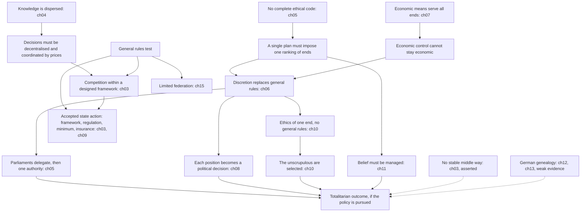

# Synthesis: The Road to Serfdom

Reading purpose: "Understand and critically evaluate Hayek's argument in full, and leave notes solid enough to support later cross-book thematic syntheses." The reader did not state a purpose; this one is inferred from how this repository is used. Section 4 should be rewritten if the real purpose differs.

Page numbers are `[[page N]]` markers in this workspace's `source.txt` (500-word synthetic pages, not printed pages). Unit notes are in `notes/`; the ledger of terms is `terms.md`.

## 1. What is the book about as a whole?

The book asks whether a free society can direct its economic life by a central plan and remain free. Hayek's answer is that it cannot. He defines the thing he is attacking narrowly, as central direction of all economic activity according to a single plan (p. 82), and says his criticism is aimed solely at planning against competition (p. 87). He treats socialism as one species of this method and holds that the consequences follow from the method whatever ends it serves (p. 81).

It is a political book and says so: the argument rests on declared ultimate values (p. 37). It is a warning to people Hayek regarded as well-meaning, the socialists of all parties of the dedication (p. 37, p. 39). It is also, by his own account, critical and not constructive: it offers no programme for domestic order (pp. 234-235).

This edition adds a second layer. Hayek's 1956 foreword and 1976 preface revise the claim, and the editor's introduction and the appended readers' reports argue about what the claim was. The book therefore contains its own reception, and a reader has to keep four voices apart: Hayek in 1944, Hayek later, the editor, and the contemporaries.

## 2. What is said in detail, and how?

### The main line

1. **Definitions (ch03).** Socialism names both a set of ends and a method; the dispute is about the method (p. 80). Planning in the condemned sense is central direction by one plan (p. 82). The alternative is competition as a way of coordinating effort, which Hayek prefers because it is the only method that needs no arbitrary intervention by authority (p. 83).
2. **Knowledge (ch04).** No one can survey the facts of a complex economy, so decisions must be decentralised and coordinated by prices, which register and transmit what each person needs to know (pp. 91-92). Planning is not forced by technology: the growth of monopoly came from policy (pp. 88-91).
3. **Values (ch05).** A single plan presupposes a complete ethical code that ranks every need of every person. No such code exists and no mind could hold one (pp. 97-98). People can agree to plan without agreeing on ends, so parliaments cannot produce a plan; they delegate, and the demand grows for a single authority (pp. 100-104).
4. **Law (ch06).** The Rule of Law means government bound by rules fixed and announced beforehand (p. 109). Planning needs decisions about particular cases, which cannot be rule-bound, so law becomes an instrument of whoever decides (pp. 109-112). A policy aiming directly at a substantive ideal of distributive justice must destroy the Rule of Law (p. 113).
5. **Scope (ch07, ch08).** Economic control is "control of the means for all our ends" (p. 123), so it cannot stay economic. Once the state settles incomes, each person's position is a political decision with no agreed principle behind it, and groups fight to control the state (pp. 132-136).
6. **Limits (ch09).** Security against severe privation can be given to all outside the market; security of a particular income or status can be given only to some, by excluding others (p. 144).
7. **Consequences (ch10, ch11).** The group able to impose one view is selected for low common standards, credulity and a shared enemy (pp. 156-157). An ethics of one overriding end has no general rules (p. 161). Because the plan's values must be justified by claims of fact, official doctrine extends to facts, language and science (pp. 169-175).
8. **History (ch12, ch13).** German writers from 1914 identified organisation with socialism and treated liberalism as the enemy (pp. 179-185). Britain in the 1940s is said to show the same ideas, with organised capital and organised labour jointly backing monopoly (pp. 190-200).
9. **Abroad (ch15).** Agreement on ends thins as scale grows, so international planning must rest on force (pp. 222-223). The remedy is a federation with strictly defined, mainly negative powers (p. 229).

### One contrast doing most of the work

The same formal distinction recurs in each field: rules that are general and indifferent to particular ends, against direction toward particular ends. It appears as competition against central direction (p. 83), formal against substantive law (p. 110), individualist against collectivist ethics (p. 161), truth found by individual conscience against truth laid down by authority (pp. 174-175), and rules of the game against a ranking of nations' needs (p. 228). The book's unity lies here more than in its history.

### What Hayek accepts

The list is long and is the part most often lost.

- A monetary system and the prevention or control of monopoly (p. 68).
- A designed legal framework, including reform of property, corporation and patent law (pp. 83-84).
- Bans on poisons, limits on working hours and sanitary rules (p. 84).
- "an extensive system of social services" that does not make competition ineffective over wide fields (p. 84).
- Roads, and regulation of smoke, noise and deforestation (pp. 84-85).
- Weights and measures, fraud prevention, building regulations and factory laws (pp. 114-115).
- A minimum of food, shelter and clothing "sufficient to preserve health and the capacity to work" for everybody (p. 144).
- State help in organising social insurance for sickness and accident, and disaster relief (pp. 144-145).
- Policy against the business cycle, by monetary means for preference (p. 145).
- Strong state control, including price control, of unavoidable monopolies (p. 200).
- Gradual, not sudden, removal of wartime controls (p. 219).
- A powerful international authority confined to enforcing rules (pp. 229, 231).

He rejects laissez faire as a description of liberal policy (p. 68, p. 114). The list includes a legal and regulatory framework within which competition operates, and substitutes where competition cannot be made effective (pp. 83-85). Minimum security is a distinct case: Hayek places its provision outside the market, while rejecting guarantees of particular incomes or positions that restrict competition (p. 144, p. 152).

### How the claim changes after 1944

- **1944.** The outcome is not inevitable and can be prevented (p. 58). The same pages say fascism was a necessary outcome of earlier socialist trends (p. 58).
- **1956.** State socialism of the old kind is nearly dead; the welfare state has replaced it, with some laudable aims and dangerous instruments (pp. 42-43). Six years of Labour government did not produce a totalitarian state, and Hayek answers that the important change is a slow alteration in a people's character (p. 46).
- **1976.** In 1944 socialism meant nationalisation and central planning; it now chiefly means redistribution and the welfare state, which Hayek says tends to very much the same outcome more slowly (p. 55). He denies having claimed that any movement toward socialism must end in totalitarianism, and he regrets unspecified concessions to interventionism (p. 55).

## 3. Is it true, in whole or in part?

### What holds

- **The values argument (ch05).** Directing all economic activity does require ranking ends that people rank differently, and the choice of ends cannot be delegated as a technical matter. This is an argument from the nature of the task and does not depend on the German history. Verdict: sound against comprehensive planning.
- **The form of state action matters, apart from its size.** The distinction between general announced rules and discretion over particular cases (p. 109) is a real one and usable.
- **The second-kind security argument.** Protecting particular incomes shifts insecurity onto those outside the protected group (pp. 149-151). The mechanism is clear and stands by itself.
- **The book is not a case against the state.** The text supports this beyond dispute (p. 85, p. 114, p. 144).

### Where the author is wrong or overreaches

- **The boundary and dynamic of partial planning remain insufficiently established.** Hayek distinguishes rules supporting competition, substitutes where competition cannot work, and planning that suppresses workable competition (pp. 83-87). His acceptance of regulation and price controls for unavoidable monopolies (p. 200) therefore does not itself contradict his rejection of planning against competition. The question is whether measures that displace competition must lead toward comprehensive control: he sketches that progression through industrial monopolies (p. 86) and argues that interventions generate pressure for further interventions (p. 133), but does not establish how generally it follows or give a clear practical boundary. My criticism concerns the reach of this argument, not a contradiction between all regulation and competition.
- **The threshold is never given.** The state is said to control almost everything indirectly once its share passes a certain proportion, with one German figure of 53 per cent of national income offered in support (p. 100). No proportion is named and no mechanism is shown.
- **The historical thesis claims more than its evidence shows.** Chapter 12 says the support that brought Nazi ideas to power came from the socialist camp (p. 178). Its evidence is a line of anti-liberal writers, several of them former Marxists (pp. 179-185). It says nothing about voters, the conduct of the socialist parties, or conservative elites, and Hayek concedes the ideas were a minority strand before 1914 (p. 178). The argument also depends on a wider meaning of socialism than the definition in chapter 3 (p. 179 against p. 80). Knight, a sympathetic reader, judged that such points weaken the argument (p. 242), and the editor largely agrees, calling the book "a punch line without the joke" (p. 19).
- **Quotations of opponents are unreliable in places.** The editor records that Hayek dropped a qualifying clause from the Carr sentence on which the comparison with Carl Schmitt rests (p. 203), altered a word in Lensch (p. 188), and that the Voigt passage could not be found (p. 79). These are the editor's findings, not mine; the practical consequence is that Hayek's quotations should be treated as paraphrase unless the editor confirms them.

### Where the author is incomplete

- **Where to draw the line.** The formal test is admitted to be "most difficult to draw precisely in practice" (p. 110), and chapter 6 uses three tests as if they were one: general form, ignorance of who will benefit, and permanence without intent to favour (p. 110, p. 115). Which one governs decides whether redistribution by general rule is excluded by the claim on p. 113. Keynes, Marschak and Hayek himself all register the gap (p. 20, p. 243, pp. 234-235). This is a gap, not an error; Hayek says his later books were written to fill it (p. 54).
- **The concessions are later withdrawn without being named.** The 1976 preface regrets concessions he had come to think unwarranted and does not say which (p. 55). A reader cannot tell how much of the list in section 2 the later Hayek still held.
- **Markets are defended as impersonal, not as just.** Hayek concedes that the Rule of Law produces inequality (p. 113), that luck counts as much as skill and chances are unequal (p. 131), and that the price of choice is often cruelly high (p. 126). His case is that no one's will decides the result (p. 131). He does not address that the rules producing the result are themselves chosen.

### What I cannot verify

- **Slow change of national character.** This is the 1956 reply to the objection from British experience. Hayek himself says such changes are not easily demonstrated (p. 46). No evidence in this volume settles it either way.
- **That welfare-state socialism tends to the same outcome.** The 1976 statement (p. 55) comes with no mechanism specific to that extension. Friedman reports that the expected advance of central planning was checked after 1945, but continues that government growth shifted into indirect regulation and transfer programs (pp. 250-251). He regards subsequent experience as confirmation of Hayek's central insight (p. 251). My assessment is narrower: this volume does not establish that welfare-state policies lead to the same outcome as comprehensive planning.
- **The sociology of fascism in chapter 8** (a revolt of a newly underprivileged middle class, pp. 140-141) and the moral-decline thesis of chapter 14 (pp. 213-216) are asserted with little or no evidence.

### The inevitability dispute

Three readings are on offer. Knight in 1943 read the thesis as a claim of inevitability (p. 241). The editor reads it as a logical argument that full central planning cannot coexist with liberal freedoms, and concludes that the welfare states do not test it because "a welfare state is not socialism" (pp. 25-26). Hayek's own text supports a third reading that fits the evidence best: a conditional tendency. The outcome is not historically fated (p. 58), but if the policy is pursued the consequences follow (p. 48), and each step makes the next more likely (p. 133).

The editor's defence and the author's later position are not the same. The editor protects the thesis by confining it to full socialism (p. 26). Hayek in 1976 extends it to the welfare state (p. 55). The first limits which democratic experiences can test the thesis; the second extends the claim to welfare-state policies. Friedman's account distinguishes the retreat of central planning from continuing government growth through regulation and transfers, and he judges the wider experience to confirm Hayek's central insight (pp. 250-251). My inference differs: neither the retreat nor the continued growth, by itself, establishes the predicted outcome for welfare states.

## 4. What of it?

Against the purpose of building notes for cross-book work, four things are worth carrying forward.

- **Use the book for its criterion, not its prophecy.** The durable contribution is the question of what form a state action takes: a general rule known in advance, or a discretionary decision about particular people (p. 109). That question can be put to any other author on planning, welfare or regulation.
- **Quote Hayek on what he accepts.** Any theme that sets this book against social-democratic or welfare-state writers should start from the concessions (p. 84, pp. 144-145), since most disagreement with him lies inside that territory and not at its border.
- **Treat three questions as open and worth pursuing in other books.** Where is the line between regulation and planning against competition? Does partial planning have the dynamic Hayek asserts on p. 133? Does impersonality justify outcomes when the rules are chosen?
- **Do not cite this book for the causes of Nazism.** Cite it for the claim that well-meant ideas can prepare ground for movements their holders detest (p. 58), and cite Knight (p. 242) and the editor (p. 19) for why the historical case is weak.

For anyone tracing Hayek's own development, this volume also fixes the starting point: he says the positive account missing here is in The Constitution of Liberty and Law, Legislation, and Liberty (p. 54).

## Concept map

Solid arrows are steps the text argues. Dotted arrows are steps it asserts or supports weakly; the conclusion's reach beyond comprehensive planning depends on them.

## Verification log

Mechanical check: `verify-quotes.sh` — 558 checked, 558 ok, 0 near, 0 fail, 0 skipped → nothing outstanding. First runs flagged lines in several notes (paraphrases left in quotation marks, wrong page on multi-quote lines, two real misquotations in ch08); all were fixed by the readers before this run.

Hand-verified paraphrased claims (the most load-bearing), each re-read on the cited page:

- ✓ verified — Planning in the condemned sense is central direction of all economic activity according to a single plan (p. 82) — the sentence is on p. 82 in those terms.
- ✓ verified — A single plan presupposes a complete ethical code, and none exists (pp. 97-98) — presupposition stated on pp. 97-98, the denial on p. 98.
- ✓ verified — The Rule of Law means government bound by rules fixed and announced beforehand (p. 109) — definition on p. 109.
- ✓ verified — A policy aiming directly at distributive justice must destroy the Rule of Law (p. 113) — stated on p. 113.
- ✓ verified — A mixture of competition and central direction is said to work worse than either (pp. 86-87) — the passage on p. 87 says neither will really work.
- ✓ verified — Hayek accepts a guaranteed minimum and state-organised social insurance (pp. 144-145) — minimum on p. 144, social insurance on p. 145.
- ✓ verified — Hayek denies inevitability in the Introduction and denies the slippery-slope reading in 1976 (p. 58, p. 55) — both passages confirmed.
- ✓ verified — In 1956 Hayek concedes six years of Labour did not produce a totalitarian state and shifts to change of character (p. 46) — confirmed on p. 46.
- ✓ verified — The editor says the welfare states do not test the thesis because a welfare state is not socialism (p. 26) — confirmed on p. 26.
- ✓ verified — Friedman reports the collectivist advance did not go much farther after 1945 (p. 250) — confirmed on p. 250.

Limits of this read: the analytical pass was done by six readers in separate contexts, each checking its own notes against the text. This synthesis was written from their notes and reports, and I re-read only the pages listed above. One unit boundary cut the editor's last footnotes (pp. 36-37) out of the first pass; I read them afterwards and added them to the fm01 note. Cross-references between units that a reader marked as unconfirmed are flagged inside the notes.

Review-correction verification: the 558-check result above records the original verification. After the review corrections and paraphrasing of two long quotations, the current run of `verify-quotes.sh` reports 556 checked, 556 ok, 0 near, 0 fail and 0 skipped. This mechanical check covers eligible quoted spans, not all prose. Revised paraphrases were checked against their cited source pages.
