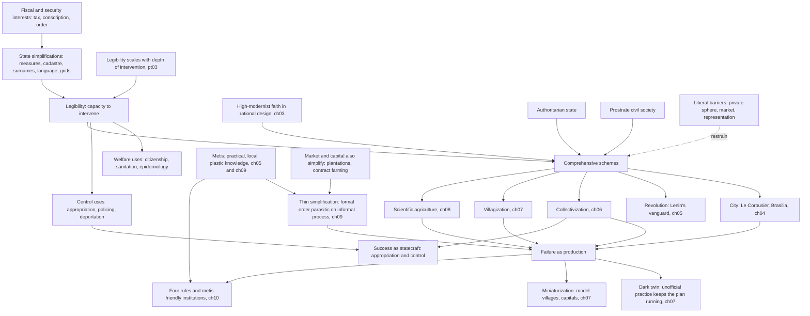

# Synthesis: Seeing Like a State

Reading purpose: "Understand and critically evaluate Scott's argument in full, and leave notes solid enough to support later cross-book thematic syntheses." The reader did not state a purpose; this one is inferred from how this repository is used.

Page numbers are `[[page N]]` markers in this workspace's `source.txt` (500-word synthetic pages, not printed pages). The synthesis is written from the twelve unit notes in `notes/` (fm01, ch01 to ch05, pt03, ch06 to ch10) and the ledger in `terms.md`, not from the raw text. Every chapter's endnotes were read (the Introduction has none); for ch01 to ch03 they were folded in after the body notes were written. Endnote material is cited by its own page (pp. 284-369).

## 1. What is the book about as a whole?

It explains why well-intended state schemes of social engineering went "so tragically awry" (p. 9). The explanation has two layers.

- **A causal recipe.** Disaster needs the administrative ordering of nature and society, a high-modernist ideology, an authoritarian state and a prostrate civil society, all four together (pp. 9-10). Chapter 3 restates this as three elements, folding legibility into high modernism (ch03, p. 71).
- **A reason for failure.** Any planned order is a thin simplification. Formal order is always parasitic on informal process and practical knowledge, metis, that it does not recognise and cannot create (p. 10; ch09, p. 243). Schemes that ignore or suppress metis fail as production and survive only through the unofficial practice they forbid (ch07, p. 205; ch09, p. 243).

The book is framed as a case against the "imperialism" of planned order, not against planning or the state (pp. 11-12; ch09, p. 269). It ends with four planning rules (small steps, reversibility, planning on surprises, planning on human inventiveness, ch10, pp. 273-274) and a case for institutions shaped by metis (ch10, p. 280).

## 2. What is said in detail, and how?

The book moves from instrument (Part 1) to ideology (Part 2) to cases (Part 3) to theory and lessons (Part 4).

- **The parable (ch01).** German scientific forestry reduced the forest to commercial timber, then rebuilt the forest to match its tables (pp. 16-17). It worked for one rotation and then lost 20 to 30 percent of production, because what it had bracketed sustained the yield (pp. 19-20). The parable is the template for every later case: ch06 likens wheat to the Norway spruce (ch06, p. 173), and ch08 reverses the genealogy, saying agriculture was the model for forestry (ch08, p. 206).
- **Legibility (ch01, ch02).** Customary measures, tenure, names and settlement were local and illegible to the centre, so states imposed standard measures, the cadastre, surnames, an official language and grid plans, which then transformed the practices they recorded (ch01, pp. 23, 34, 37; ch02, pp. 47-64). Legibility is an amplifier for welfare or for control; the Amsterdam map of 1941 shows the lethal use (ch02, p. 66). Part 3 sharpens this into a rule: the deeper the intended intervention, the more legibility it needs (pt03, p. 144).
- **High modernism (ch03).** A faith in comprehensive rational design carried by engineers, planners and technocrats of left and right (ch03, pp. 71-72), authoritarian in logic because it grants standing only to scientific knowledge (ch03, pp. 75-76). It becomes lethal only with unrestrained power and a society unable to resist; a private sphere, markets and representative institutions have restrained it (ch03, pp. 72, 82-83).
- **The city (ch04).** Le Corbusier's single-composition city and its built form in Brasilia and Chandigarh are set against Jane Jacobs's account of cities as unplanned, many-handed orders whose visual disorder hides working order (ch04, pp. 83-115). Brasilia's planners provided no housing for its builders, who built the unplanned Brasilia that became most of the city (ch04, pp. 100-101). A planned city starts thin and only time makes it thick (ch04, p. 113).
- **The revolution (ch05).** Lenin's vanguard party is read as the planner's elite applied to revolution: a machine to produce a revolution, which treats the workers as raw material (ch05, pp. 116-120). The revolution of 1917 was not made by the vanguard but captured by it (ch05, p. 125), and the official story that it was planned is itself a state simplification (ch05, p. 127). Luxemburg and Kollontay play Jacobs's role; metis is first defined here as knowledge acquired only by long practice at similar but rarely identical tasks (ch05, p. 142).
- **Rural settlement (pt03).** Most states are younger than the societies they govern, which are opaque to them, often on purpose (pt03, p. 144). Rulers create and expand state spaces of settled, taxable cultivation (pt03, p. 146). Colonial regimes preferred plantations although smallholders were more efficient (pt03, p. 148), and Malaysian FELDA schemes paid a political rather than an economic dividend (pt03, p. 150). A resettled community is a demobilized one (pt03, p. 151).
- **Soviet collectivization (ch06).** The giant mechanized farm was a high-modernist faith shared by American and Soviet agronomists, not a Marxist doctrine (ch06, p. 156). Collectivization failed as a scheme of production but worked as an instrument of the twin goals of traditional statecraft, appropriation and control (ch06, p. 159); its overriding purpose was the seizure of grain, filtered through a high-modernist lens (ch06, pp. 165-166). The kolkhoz resembled a second serfdom (ch06, p. 168). Institutional preferences can be ranked by legibility (ch06, pp. 171-172), and crops by their fit with centralization (ch06, p. 173).
- **Tanzanian villagization (ch07).** Ujamaa tests the model on a benign, weak, development-minded state without Stalinist appropriation, and the family resemblances persist (ch07, p. 175). The plans were aesthetic, not scientific (ch07, p. 198); bureaucratic goal displacement was inherent (ch07, p. 191); no state could have gathered the information a schematic plan needed (ch07, p. 193). When large plans fail, high modernism retreats into miniatures such as model villages and capitals (ch07, p. 202), and a rigid plan needs a proportionate dark twin of unofficial practice (ch07, p. 205).
- **Scientific agriculture (ch08).** The failures of Western agriculture abroad were systemic, built into agronomic science (ch08, p. 207). Monoculture invites epidemics, as in the 1970 corn blight (ch08, pp. 211-212); polyculture failed a visual test (ch08, p. 215); experimental method has an elective affinity with simplified farming (ch08, p. 229); and the science plans for a stock Everyman cultivator who wants only maximum yield (ch08, p. 236). Andean craft farming runs the opposite logic (ch08, pp. 237-238).
- **Metis (ch09).** Metis is practical, local, plastic knowledge that lies between genius and rote, whose essence is knowing when to apply rules of thumb (ch09, pp. 246-249). It differs from techne, universal and teachable knowledge, which describes science's self-image more than its practice (ch09, pp. 251-252). Its test is practical success (ch09, p. 255). States and bureaucratic capitalism destroy it as a project of control and appropriation, because dispersed knowledge cannot be appropriated (ch09, pp. 265-266); Taylorism and contract farming are the industrial and agrarian forms (ch09, pp. 266-269). The danger is the combination of universalist epistemic pretension and authoritarian social engineering (ch09, p. 269).
- **Conclusion (ch10).** The one-sentence diagnosis: planners thought themselves far smarter than they were and their subjects far less capable (ch10, p. 272). Abstraction is the necessary first premise of large-scale planning (ch10, p. 274); a first map of planned functions alone is unsustainable without the second map of everything else going on (ch10, pp. 275-276); thin designs produce the passive subjects they assumed (ch10, p. 277). Every formal order, the market included, is a subsystem parasitic on a larger one (ch10, p. 279). The positive programme is institutions that members continually reshape: democracy, common law, language (ch10, pp. 280, 283-284).

## 3. Is it true, in whole or in part?

Verdicts are kept apart: well supported, wrong here (with a page-cited reason), incomplete, and cannot verify.

**Well supported**

- That standardizing measures, tenure, names and language increased central capacity and shifted power to those who could read the new codes. The evidence is varied and comes from several countries (ch01, ch02).
- That formal organizations depend on informal practice they do not record. The work-to-rule strike (ch09, p. 243), the East German fixer and barterer (ch10, p. 278), the unplanned Brasilia (ch04, pp. 100-101) and the persistence of private plots under collectivization (ch06) all point the same way, from different fields.
- That collectivization served appropriation and control. Scott follows a historians' consensus (Fitzpatrick, Conquest) that grain seizure was the overriding purpose (ch06, p. 165), and the production figures for the 1920s collective sector are stark (ch06, p. 164).
- That monoculture creates genetic vulnerability, on the corn-blight evidence (ch08, pp. 211-212).

**Incomplete**

- *The causal model drifts.* Four necessary elements in the Introduction (pp. 9-10) become three in chapter 3 (ch03, p. 71), two in chapter 9 (ch09, p. 269), and none in the conclusion, whose headline diagnosis is about planners' knowledge and attitude (ch10, p. 272). Power and civil society survive mainly to explain where the damage was worst (ch10, p. 271). The cases do not fit one recipe: Brasilia was built by an elected government in a competitive political system (ch04, p. 101), and Tanzania was a weak state whose peasants could evade it (ch07). Neither is tested against a case where the elements were present and disaster did not follow.
- *Ideology against appropriation.* Part 3 explains settlement schemes by plain appropriation logic and barely uses the term high modernism (pt03, pp. 146-151). Chapter 6 names the relation between ideology and appropriation an elective affinity (ch06, p. 171) without weighing them, and concedes the failure was overdetermined (ch06, pp. 172-173). Chapter 7 sets out to remove appropriation, but its endnotes bring it back through a fiscal crisis and the gains of the official class (ch07; endnotes, pp. 342-343).
- *Sincere planners or interested ones.* The conclusion insists the planners were tragic, not cynical (ch10, p. 271), yet in the same chapter says the kolkhoz, ujamaa and Ethiopian layouts were designed above all for central administration and control (ch10, p. 276), and chapter 9 gives the destruction of metis a logic of control and appropriation (ch09, p. 266). Two explanations, epistemic blindness and interest, run side by side and are never reconciled.
- *Markets.* The Introduction promises that the lessons apply to market standardization (p. 12). Chapter 8 delivers part of this (simplification driven by machinery and capital, ch08), and chapter 9 treats plantations and contract farming as private collectivization (ch09, pp. 268-269). But the conclusion gives the market one paragraph as a parasitic subsystem (ch10, p. 279) while its positive examples (family farms, Emilia-Romagna firms) are competitive market actors (ch10, p. 281).
- *The barriers are weaker than chapter 3 says.* An endnote concedes that high-modernist schemes ran under liberal democracy too, citing sterilization laws in 23 of 48 US states by 1926 (ch03; endnote, p. 307), and that reactionary schemes were as common as progressive ones (ch03; endnote, p. 306). Welfare intent is built into the definition, so settler and counterinsurgency resettlements are set aside (ch03; endnote, p. 308). Scott also partly retracts his picture of the uniform Russian commune (ch01; endnote, p. 292), and records a reader's objection that officials are not more abstract than anyone else, while keeping the term simplification (ch02; endnote, p. 303).
- *Benefits are stated, not weighed.* Le Corbusier's city would have been healthier than the slums (ch04, p. 92); Brasilia was rather egalitarian (ch04, p. 98); Green Revolution yields are granted (ch08); villagization brought services and may have eroded age and gender hierarchies (ch07; endnote, p. 343); the conclusion lists four considerations that temper its condemnation (ch10, pp. 279-280). None enters the final balance.
- *Metis is a bundle.* It covers bodily skill, local facts, cunning, collective lore and incremental method (ch09). The book gives no criterion for which losses of metis are welcome and which harmful; it grants that many are welcome (ch09, p. 265). It calls the market for metis near perfect competition (ch09, p. 262) and then says metis can be monopolized (ch09, p. 265). In the conclusion metis is both destroyed (ch10, p. 277) and indestructible (ch10, p. 278).
- *Evidence quality varies by chapter.* The forestry parable rests on a small secondary literature and a mechanism said to be not fully understood (ch01, p. 19). The American industrial-farm story rests on one unpublished manuscript (ch06). The Ethiopian case comes mainly from a refugee-interview report (ch07). Chapter 8 leans heavily on Richards and one Andean study (ch08; endnote, p. 348). Much of chapter 9 is anecdote and hearsay (ch09, pp. 259-260). Scott disclaims regional expertise for the Soviet case (ch06, pp. 151, 170).

**Wrong here**

- Chapter 8 says experimental agricultural method cannot handle many interacting variables (ch08, pp. 227-228). Outside knowledge: factorial field designs were developed for exactly that. Scott's own account of institutional incentives (ch08, p. 231) is the stronger version of his point.
- Smaller factual slips are recorded in the notes, none of which affects the argument: Brasilia placed near the Pacific (ch04, p. 95), "Sir William Jenner" and a "killed virus" vaccine (ch09, pp. 256-257), the Soviet famine dated 1933-34 (ch06, p. 167), and several endnote misattributions (Fitzgerald for Fitzpatrick, ch06; Averich for Avrich, ch05). The flags rest on outside knowledge and are labelled as such in each note.

**Cannot verify**

- Several figures carry no source: the Soviet death toll range (ch06, p. 158), the semiarid-sites figure for Tanzania (ch07, p. 188), the claim that three-quarters of the pharmacopoeia derive from traditional medicine (ch09, p. 256), and Pruitt-Igoe and Levittown in the conclusion (ch10).

## 4. What of it?

For cross-book work:

- **A general theory of administration.** Legibility and thin simplification describe what any large organization must do to act at all, which Scott says himself (ch02, pp. 66, 69; ch10, p. 279). The two-maps image (ch10, pp. 275-276) and the dark twin (ch07, p. 205) are portable tools for reading any formal system against its informal practice.
- **Direct comparison with The Road to Serfdom.** Scott's metis argument parallels Hayek's dispersed-knowledge argument closely (ch09; ch10, p. 273), and the liberal barriers to high modernism (ch03, pp. 82-83) are Hayekian in shape. But Scott cites Hayek only in endnotes for this point (ch03; endnote, p. 310; ch09; endnote, p. 362), says Hayek and Kropotkin agree on this alone (ch10, p. 273), refuses the market conclusion (p. 12), prefers Polanyi on the market as itself imposed (ch04; endnotes, pp. 317-318; ch07, endnote, p. 346), and extends the critique to the capitalist firm (ch09, pp. 266-269). The shared point is epistemic; the disagreement is about whether markets escape it.
- **A checklist with limits.** The four elements give a test for when a scheme is dangerous, and the four rules (ch10, pp. 273-274) a test for designing one. Both should be used knowing that the book itself drifts on how the elements combine, and that its rules are weakest in the crises that empower planners (ch10, p. 271; endnote, p. 368).
- **For later themes** on tacit knowledge, state capacity, colonial development and agrarian change, the most reusable units are ch09 (metis), ch01 (legibility), ch06 and ch07 (the paired cases), and pt03 (state and nonstate spaces).

## Concept map

## Verification log

Mechanical check: `verify-quotes.sh` was run on the whole workspace after this synthesis and the rebuilt `terms.md` were written; the result is recorded in the last line below.

Load-bearing paraphrases re-checked by targeted search of `source.txt`:

- Four elements, all necessary (pp. 9-10): p. 9 says all four are necessary for a full-fledged disaster. ✓ verified
- Three elements in chapter 3 (ch03, p. 71): p. 71 names a combination of three. ✓ verified
- Forestry loss in the second rotation (ch01, pp. 19-20): p. 19 places the damage after the second rotation of conifers. ✓ verified
- Collective sector of the 1920s (ch06, p. 164): p. 164 gives 10 percent of the labour force against 2.2 percent of output. ✓ verified
- Grain seizure as the overriding purpose (ch06, p. 165): stated on p. 165. ✓ verified
- Plantations preferred though not on grounds of efficiency (pt03, p. 148): stated on p. 148. ✓ verified
- Generic features of developmentalist states in the Tanzanian case (ch07, p. 175): stated on p. 175. ✓ verified
- Formal order parasitic on informal process (ch09, p. 243): stated on p. 243. ✓ verified
- The dangerous combination of epistemic universalism and authoritarian engineering (ch09, p. 269): stated on p. 269. ✓ verified
- One-sentence diagnosis (ch10, p. 272), planners not cynical (ch10, p. 271), designed for control of public life (ch10, p. 276), the market as an instituted formal system (ch10, p. 279), Emilia-Romagna as an example (ch10, p. 281): each found on the cited page. ✓ verified

- Short quotations the script does not test ("so tragically awry", "imperialism", "Sir William Jenner", "killed virus") were found by search on the cited pages (pp. 9, 11, 256, 257). ✓ verified

verify-quotes.sh result (whole workspace, all twelve notes plus terms.md and this file, run 2026-11-18): checked 517, ok 517, near 0, fail 0, skipped 0; exit 0. Re-run after the ch01 to ch03 endnotes were folded into their notes.
