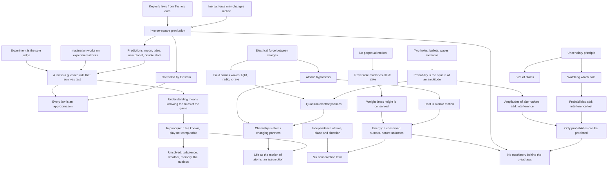

# Synthesis: Six Easy Pieces

Reading purpose: "Understand Feynman's account of what physics knows and how it knows it, evaluate it, and leave notes solid enough to support later cross-book thematic syntheses." The purpose was not stated by the reader; it is inferred from this repository's use.

Page numbers are `[[page N]]` markers in this workspace's `source.txt` (500-word blocks, not printed pages). This synthesis is written from the nine notes in `notes/` and from `terms.md`. Equations, figures and two tables are missing from this edition's text, so quantitative steps are reported in words.

## 1. What is the book about as a whole?

It is a beginner's map of physics as it stood in 1963, taken from the first-year lectures Feynman gave at Caltech, and at the same time an account of what kind of knowledge physics is. The publisher chose the six most qualitative chapters of the Lectures (p. 1). Feynman had not designed them as a popular book; he says he aimed at the most intelligent student in the class (p. 12).

The content answer is that matter is atoms in perpetual motion (p. 17), held together by electrical forces between charges (p. 32), obeying a small number of laws: conservation of energy (p. 57), gravitation (p. 68) and, underneath everything, the quantum rules (p. 96). The method answer is that laws are guessed and then tested by experiment, which is the only judge (p. 16), and that every law so far is an approximation (pp. 15–16).

The finding that ties the chapters together is that the deepest laws are abstract. Energy is a number that stays the same and physics does not know what it is (p. 59). Newton gave no machinery for gravity and nobody has since (p. 79). No one has found machinery behind the quantum rules (p. 96). Feynman reports this three times with different material, and treats it as the actual condition of knowledge.

The three prefatory pieces add a second subject: the teacher. Davies describes an intuitive, anti-formal style (pp. 3–4). Goodstein and Neugebauer report that the course lost its undergraduates and kept the faculty (p. 10). Feynman's own verdict is that he did not do well by the students (p. 14).

## 2. What is said in detail, and how?

**The structure.** Three chapters draw the map: what matter is (ch01), what the fundamental rules and particles are (ch02), and how physics stands to the other sciences (ch03). Three chapters each take one law and work it: energy (ch04), gravitation (ch05), quantum behavior (ch06). Feynman says the first three are an outline so that later detail can be placed (p. 15), and that ch04 begins the more detailed study (p. 57).

**The method, stated first.** Physics cannot be taught from axioms, because not all the laws are known and the true ones need unfamiliar ideas (p. 15). Laws come from imagination working on experimental hints (p. 16). A law that was good, constant mass, turned out to be wrong by a tiny amount at ordinary speeds and wrong in its whole picture of the world (p. 16). ch02 turns this into an image: nature is a chess game played by the gods, we watch and infer the rules, and knowing the rules is what understanding means (p. 29). Rules are checked in simple corners, through general consequences such as the bishop keeping its colour, and by rough approximation (pp. 29–30). The places where rules fail are the interesting ones (p. 30).

**Atoms.** If one sentence had to carry the most information, it would be the atomic hypothesis (p. 17). Feynman magnifies a drop of water and reads off heat as jiggling (p. 18), pressure as bombardment (p. 19), evaporation and its cooling effect (pp. 22–23), dissolving as a balance of rates (pp. 23–24) and burning as atoms changing partners (pp. 24–25). The evidence is successful prediction, Brownian motion and crystal geometry (p. 27).

**Forces and fields.** The force between atoms is electrical, far stronger than gravity and almost perfectly cancelled in ordinary matter (pp. 32–33). Direct attraction gives way to the field, because a shaken charge sends out an influence that travels and falls off slowly (pp. 33–34). Light, radio and x-rays are one thing at different frequencies (pp. 34–35). Quantum mechanics then merges field and particle (p. 38), and quantum electrodynamics holds the rules for all ordinary phenomena except gravitation and nuclear processes (p. 38). Inside the nucleus the picture in 1963 was a list of about thirty unexplained particles (p. 40) and four interactions, one of whose laws was unknown (pp. 42–43).

**The other sciences.** Chemistry is physics in principle, and the qualification matters: knowing the rules is not being able to play (p. 44). Biology's most powerful assumption is that everything living things do is the motion of atoms (p. 51). The chapter gives enzymes, proteins and DNA as cases (pp. 47–51), stars as the same atoms shining by nuclear reactions (pp. 51–53), and then a list of what physics cannot do: weather (p. 53), the earth's interior (p. 54), memory (pp. 54–55), turbulent flow (p. 56). The other sciences also ask how things came to be as they are, a question physics did not then ask of its laws (pp. 55–56).

**Energy.** The law says a certain quantity does not change, and it describes no mechanism (p. 57). The Dennis story shows a conserved count being rescued by adding computed terms, with the moral that in physics there are no blocks, only the terms (p. 58). Feynman then derives the gravitational term. Assume no perpetual motion (p. 59). Then nothing beats a reversible machine (p. 60), all reversible machines lift equally (pp. 60–61), and a rack of three balls shows that weight times height is conserved (pp. 61–62). He adds at once that the reasoning might be untrue and has to be checked (p. 62). Heat turns out to be kinetic energy of atoms (pp. 65–66). There are six conservation laws, three tied to symmetries of space and time and three that are simple counts (pp. 67–68).

**Gravitation.** Tycho measured, Kepler found three laws, Galileo found inertia, and Newton saw that the force must point at the sun and fall off as the inverse square (pp. 69–71). The test is prediction: the moon's fall (p. 72), the ellipse (pp. 73–74), two tides (p. 74), a new planet (pp. 75–76). A law is useful only if more comes out than went in (p. 73), and it is wrong if it fails once where it should hold (p. 75). The law reaches to double stars and galaxies (pp. 76–77) and into the laboratory with Cavendish (p. 78). Then the limits: no mechanism (p. 79), no link to other forces (p. 80), an unexplained enormous ratio to the electrical force (pp. 80–81), and the law is not correct, since Einstein modified it (p. 82).

**Quantum behavior.** One apparatus, three runs. Bullets come in lumps and their probabilities add (pp. 85–86). Water waves have continuous intensity and interfere (pp. 86–88). Electrons come in lumps and interfere (pp. 88–90). Watching which hole each electron uses removes the interference (pp. 91–92). Dimmer light only lets some electrons through unseen (pp. 92–93); gentler, redder light cannot tell the holes apart (pp. 93–94). The summary is three rules: probability is the absolute square of an amplitude; amplitudes of alternatives add; if the experiment can tell which alternative occurred, probabilities add instead (p. 96). Physics can predict only the odds (p. 96), and an electron with inner machinery that fixed its path in advance would give the wrong pattern (pp. 96–97). The uncertainty principle is what keeps the scheme consistent (p. 98).

**How it is said.** The argument runs on analogies that are each used for one precise point and then dropped: the magnified drop, the chess game, the corks in water, the blocks, the bullet that falls around the earth, the two holes. Feynman marks idealisations as he goes (pp. 17–18, 60) and admits afterwards when he has cheated (p. 65).

## 3. Is it true, in whole or in part?

**What holds.** The account of method is the strongest part and is internally consistent: experiment as the sole test (p. 16), laws as approximations (pp. 15–16), prediction beyond the input as the standard (p. 73). Feynman applies the standard to his own derivation (p. 62) and to Newton (p. 82). The qualitative physics of ch01, ch04, ch05 and ch06 is presented with its limits stated, and nothing in the text contradicts it.

**Incomplete, by the author's own account.**

- The nuclear picture: he says the theory of nuclear forces could not be calculated or checked (p. 40) and that the relations among the particles are not understood (p. 40).
- Biology: the coding problem is called unsolved (p. 51), muscle contraction unknown (p. 46), memory unknown (pp. 54–55).
- Geology: mountain building and earthquakes are not understood (pp. 53–54).
- Gravity: not made consistent with quantum mechanics (pp. 82–83).
- The derivations: the steps from Kepler's laws to a radial inverse-square force are asserted with proofs promised elsewhere (p. 71); the proof of the ellipse is not given (p. 101); the quantitative uncertainty argument is deferred (pp. 97–98).

**Incomplete as an argument.**

- The energy derivation assumes no perpetual motion, which Feynman himself calls a general statement of the law being derived (p. 59). It shows the form the gravitational term must take if the law holds. It is not a proof of the law, and he does not claim one (p. 101).
- The block analogy leaves open what stops conservation from being saved by definition, by adding a term whenever the count fails (p. 58). The text does not answer this.
- The uncertainty principle is defended in ch06 by showing that a way round it would be blocked by the principle itself (p. 97). Feynman presents this as a consistency check. The independent support offered is the success of quantum mechanics as a whole (p. 94).
- The rule about when probabilities add turns on what counts as an apparatus capable of determining the alternative (p. 96). The chapter gives two examples and no general criterion.

**Wrong here, or at least asserted without support.**

- The examples used against the philosophers' principle that the same conditions give the same result, the aurora and the pendulum in Stockholm and Quito, are cases where the conditions differ (p. 37). They do not show what the paragraph says they show; quantum indeterminacy (p. 37) is the real case and needs no such support.
- The remarks on philosophers quote and name nobody (p. 37). The verdict on psychoanalysis rests on an analogy with witch doctors plus the fair point that it had not been checked by counting cases (p. 54).
- The reductionist claim about life is called an assumption (p. 51) and a hypothesis (p. 27), and is supported only by its usefulness. The confidence of the prose exceeds the argument given.
- Two dates as printed disagree with the usual history: debates about planetary motion at the beginning of the fifteenth century (p. 69) and Roemer's measurement in 1656 (p. 75). I cannot tell from the text whether the slips are the lecturer's or the edition's.
- Feynman says a discovery shows Newton's laws are absolutely right in the solar system (p. 76) and later that Newton's law is not correct (p. 82). His own doctrine of approximate laws reconciles them, but the earlier wording is loose.

**Cannot verify from this book.**

- Whether the 1963 frontier has since moved. From general knowledge: the quark model and later theory organised the particles of ch02, the genetic code was read soon after these lectures, plate tectonics replaced the account of mountain building in ch03, and the two-slit experiment with single electrons was later performed. None of this is in the text, and the notes mark it as outside knowledge each time.
- Whether the hidden-machinery argument (pp. 96–97) is conclusive. It rests on the premise that the electron's inner state cannot depend on whether the other hole is open (p. 96). Later work on hidden variables examines that kind of premise. Feynman hedges, limiting the claim to what is known so far and to the present time (pp. 96–97).
- The numerical checks in ch05, because the fractions and the value of G are missing images in this edition (pp. 72, 78).
- Davies's claim that Feynman could write down answers in quantum electrodynamics without mathematics (p. 3).

**On the prefaces.** Davies says time symmetry directly implies conservation of energy (p. 6). Feynman's statement is conditional on quantum mechanics and on an assumption he says is unverified (p. 67). Both prefaces say ch06 presents path integrals (pp. 7, 10); the chapter gives the amplitude rules only (p. 96). In both cases the chapter text is the more careful.

## 4. What of it?

Against the reading purpose, four things are worth carrying forward.

**A usable account of what a scientific law is.** For cross-book work, this is the book's main export. A law is a compact rule, guessed, that survives test (p. 16); it is judged by whether it returns more than was put in (p. 73); it is abandoned or corrected when it fails once (p. 75); and it need not come with a mechanism (pp. 57, 79, 96). This sets a demanding standard that other books' claims to have found laws, in history or economics for example, can be measured against. ch03 already draws one such line when it asks whether a field has checked its claims by experiment (p. 54).

**A precise sense of "in principle".** Feynman separates having the rules from being able to compute with them (pp. 29, 44). Chemistry is reduced and still cannot be predicted (p. 44); the equations of air are known and the weather is not (p. 53). Any thematic synthesis about reduction, emergence or planning under complexity can use this distinction, with the caveat that Feynman treats the gap as practical and offers no argument that it is only practical.

**The historical question.** Physics, he says, has no question about how its laws came to be, while biology, geology and astronomy do (pp. 55–56). This is a clean statement of the difference between law-seeking and history-seeking inquiry, and it comes with his own admission that the line may not hold (p. 56) and one worked case of a constant that might change with time (p. 81).

**A model of exposition and its limits.** The lectures show how to carry a reader to a hard result: fix two familiar cases, then show exactly which expectation fails (pp. 84–90). They also record that this did not work as a course. Feynman's conclusion is that lectures cannot replace a student working through ideas with a teacher (pp. 14–15). Anyone using the book as evidence about teaching should use both halves.

For a reader deciding what to do next: the book is short enough to read whole, and the notes show that ch04 and ch06 repay slow reading. The particle survey in ch02 (pp. 39–43) and the sciences survey in ch03 should be read as a dated record of an open frontier. The value in them is the way ignorance is stated. An illustrated edition is needed for the figures and equations this text lacks.

## Concept map

*(hand-authored from terms.md and the chapter notes)*

## Verification log

Mechanical check: `verify-quotes.sh` — 44 checked, 44 ok, 0 near, 0 fail → clean after fixes. The first run reported 3 near (one quotation cited one page late in two notes, one cited one page early); the page numbers were corrected and the check re-run. This file contains no quotations from the book. Paraphrased page cites in the notes were assigned from a line-by-line page lookup and then spot-checked with about 150 phrase searches against `source.txt`; about a dozen cites (including cross-references between notes) were found one page off and corrected. Cites that were not individually searched may still be off by one page where a paragraph straddles a page marker.

Hand-verified paraphrased claims (the most load-bearing), each re-checked against the cited page of `source.txt`:

- ✓ verified — the atomic hypothesis is offered as the one sentence carrying the most information (p. 17) — the passage poses the cataclysm question and answers with the atomic hypothesis.
- ✓ verified — experiment is the test of all knowledge and laws are guessed from hints (p. 16) — both statements are in the same paragraph.
- ✓ verified — physics has no knowledge of what energy is (p. 59) — stated outright, followed by the denial that energy comes in blobs of definite amount.
- ✓ verified — the three-ball argument yields a third of a foot by argument alone, and the result is then said to need experimental check (pp. 61–62) — the conclusion is on p. 61; the caution and the statement that experiment confirms it are on p. 62.
- ✓ verified — conservation of energy follows from independence of absolute time only if that is assumed and quantum mechanics added, and whether it is strictly true is not known (p. 67) — the passage says exactly this, in that order.
- ✓ verified — quantum electrodynamics gives the rules for all ordinary phenomena except gravitation and nuclear processes, with no exceptions found outside the nucleus (p. 38).
- ✓ verified — the moon's computed fall fits the inverse square, and Newton's first attempt failed until the earth's size was remeasured six years later (p. 72).
- ✓ verified — for galaxies only attraction can be shown, not that the law is exactly inverse square (p. 77).
- ✓ verified — the three rules for amplitudes and the statement that no more basic mechanism is known (p. 96) — the numbered summary and the paragraph after it.
- ✓ verified — the argument against inner machinery uses the premise that what is inside the electron should not depend on whether a hole is open (p. 96), and the suspicion that the limit is permanent is hedged (p. 97).
- ✓ verified — the central unsolved problem of biology is how the order of units in DNA fixes the amino acids of a protein (p. 51).
- ✓ verified — Feynman's judgment that lectures and assigned problems alone teach little, and that the system failed most students (p. 14).

Not verifiable from this text: anything that depends on a displayed equation, a figure, Table 2-1 or Table 2-2, which are missing from the EPUB's text layer; and every statement about developments after 1963, which the synthesis and notes mark as outside knowledge.
