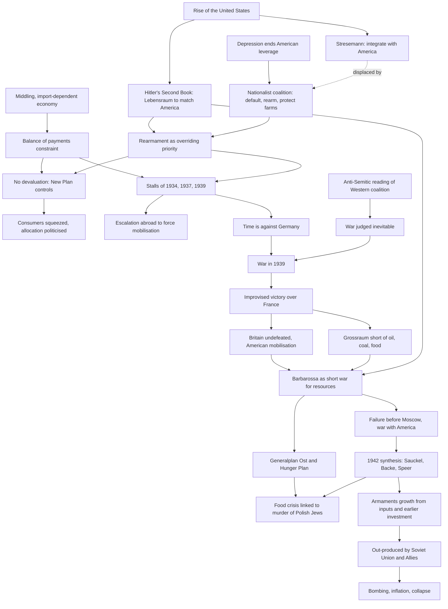

# Synthesis: The Wages of Destruction: The Making and Breaking of the Nazi Economy

Reading purpose: "a durable, checkable understanding of the book's argument (how economics explains the Nazi regime's rise, its drive to war, the Holocaust's economic context, and its defeat), for later question-answering and cross-book synthesis"

Written from the chapter notes in `notes/` and from `terms.md`. Page numbers are `[[page N]]` markers in `source.txt`.

## 1. What is the book about as a whole?

It is an economic history of Hitler's regime that claims to change the political history. Tooze's starting point is that Germany was not an economic superpower. Its income per head was middling, about half the American level and a third below the British (p. 114), and almost 29 per cent of its workforce was still on the land (p. 137). The century's dominant fact was the rise of the United States (p. 10). Stresemann answered that fact by tying Germany to American finance and trade (pp. 16-18). Hitler answered it, in the Second Book of 1928, by demanding a land empire in the East large enough to match America (pp. 20-21). The book follows what it took to attempt this with German means, and why the attempt failed.

Three claims hold the book together.

- **The regime was an effective mobiliser.** Between 1933 and 1938 it raised the military share of output from under 1 per cent to almost 20 per cent, a peacetime shift without precedent in a capitalist state (p. 515).
- **Mobilisation could not change the balance of resources.** The combined GDP of Britain, the Soviet Union and the United States in 1941 was 4.36 times Germany's (p. 501). Every step was therefore a gamble against time.
- **Ideology and economics are not rival explanations.** Hitler read a real strategic predicament through a belief in a Jewish world conspiracy, and that reading turned an unfavourable balance into a reason to attack (pp. 258, 519-520).

## 2. What is said in detail, and how?

The argument proceeds chronologically in three parts. Each part attacks a received view.

**Part I, Recovery (ch01 to ch06).** The target is the idea that the Nazi recovery was a Keynesian work-creation success that won over the population.

- The alternative to Hitler was real: Weimar's Atlanticist strategy worked until the Depression removed American power to hold the ring (pp. 18, 31, 34).
- Work creation was inherited from Schleicher, small, and ended early: no new money after December 1933 (p. 59). The acts that mattered were the debt moratorium and the 35 billion Reichsmark armaments programme, both of June 1933 (pp. 51-53).
- The binding constraint was the balance of payments. By June 1934 reserves covered barely a week of imports (p. 66). The regime refused to devalue, mainly because devaluation would raise the burden of foreign debt (p. 69), and built the New Plan: import licensing by priority, bilateral clearing, export subsidies paid by a levy on industry (pp. 80-82).
- The cost fell on consumers. Consumer-goods output hardly grew for two years (p. 83), and the "people's products" failed for want of purchasing power (pp. 129, 133).
- Business lost power to the state after the Depression (pp. 91, 96) but collaborated for profits and for the technologies of autarchy and rearmament (pp. 97, 113).
- Agrarian ideology answered a real land shortage. Since redistribution inside Germany could not solve it (pp. 146-147), it pointed to conquest (pp. 147-148, 162).

**Part II, War in Europe (ch07 to ch12).** The targets are the claims that war in 1939 was a miscalculation and that Germany won in 1940 by a planned Blitzkrieg strategy.

- In 1936 Germany could have devalued, slowed rearmament and rejoined the world economy. Hitler's Four Year Plan memorandum chose war readiness within four years (pp. 173-179).
- Rearmament then stalled three times on the same constraint: 1934, 1937 (the only pre-war year in which military spending did not rise, p. 194), and 1939, when the Wehrmacht's steel ration was cut from 530,000 to 300,000 tons a month (p. 241).
- Hitler's answer to the 1937 stall was to raise international tension, which forced mobilisation higher (pp. 194-195). The 1938 surge pushed the economy to the edge of inflation and frightened generals and ministers; Hitler stepped back at Munich (pp. 207, 214-218).
- By 1939 the huge post-Munich plans had collapsed, opponents were out-arming Germany, and the pact with Stalin opened a window. Granting Hitler's premise that war was inevitable, he had nothing to gain by waiting (pp. 247, 251-252, 256). The premise itself came from ideology (p. 258).
- War brought all-out mobilisation, not a "peacelike" war economy: armaments output doubled between January and July 1940 (p. 275).
- France fell to an improvised operational plan that concentrated force, not to superior numbers (Germany had 2,439 tanks against 4,200, p. 294) and not to a prior strategy (pp. 295-296). It was not repeatable (p. 301).
- Victory did not solve the problem. Britain could not be beaten and drew on American industry; a third of its war effort in 1940 came from abroad (p. 320). Occupied Europe was short of oil, coal and food (pp. 325-331). Only Soviet resources could sustain a long war, and trade with Stalin meant dependence (pp. 331-333).

**Part III, World War (ch13 to ch20).** The targets are the under-mobilisation thesis, the separation of the Holocaust from the war economy, and the Speer myth.

- In 1940-41 the effort was split by design: the army was equipped for a short campaign in the East while investment and the Luftwaffe prepared for the air war with Britain and America (pp. 337-338, 344-345). The plan depended on destroying the Red Army within 500 kilometres of the frontier (pp. 353-355).
- The invasion carried two programmes of mass killing. The Generalplan Ost foresaw removing 31 to 45 million people (p. 365). The Hunger Plan, agreed by the ministries and the Wehrmacht on 2 May 1941, accepted that "many millions" would starve so that the army and the Reich could be fed (p. 373). Of 3.35 million Soviet prisoners taken in 1941, only 1.1 million were alive at the end of December (p. 376).
- The premise failed by late July 1941. By autumn the war economy was at an impasse in fuel, coal and steel (pp. 384, 387-388). After the Soviet counter-offensive and the declaration of war on the United States, the managers of the war effort judged that it could not be won by military means (pp. 395-396).
- In 1942 the regime responded with a new synthesis led by ideologues, not technocrats: Sauckel's labour drafts (7.9 million foreign workers by autumn 1944, p. 403), Backe's food policy, and Speer's armaments ministry (pp. 429-430).
- Labour and genocide were related through food. Germany murdered at least 4.8 million potential workers after January 1942 (p. 408). The 1942 food crisis gave the killing of Polish Jews a function: it removed consumers from the General Government and freed grain, and European grain deliveries to Germany then doubled (pp. 424-428).
- Speer's "armaments miracle" was real growth with ordinary causes: earlier investment, more labour, and steel. Ammunition output tracks steel allocation closely before and after 1942 (p. 450). Its purpose was political, to answer the doubt that the war was lost (pp. 431-432). In the year that mattered, 1942, the Soviet Union out-produced Germany, 4:1 in tanks (p. 459).
- Bombing of the Ruhr halted the boom in mid-1943; aircraft output did not rise from July 1943 to March 1944 (p. 467). Speer then allied with Himmler and relied on coercion and wonder weapons (pp. 472-473, 478-488).
- The 1944 surge rested on earlier preparation and on violence (pp. 494-496). It made no difference: the Allies built 3.7 combat aircraft for every German one (p. 500). The economy disintegrated through inflation and through the cutting of the Ruhr's transport links (pp. 504-505, 509).

**Method.** Tooze argues from aggregate statistics (national accounts, steel allocation, armaments indices, labour counts) set against internal records of the Reichsbank, the Wehrmacht's military-economic office and the planning bodies. His recurring move is to explain outputs by inputs and lead times, and so to deflate claims that a new man (Todt in 1940, Speer in 1942, Saur in 1944) transformed efficiency (pp. 279, 450, 494-495).

## 3. Is it true, in whole or in part?

Judged from the text alone, with the limits stated at the end of this section.

**Well supported within the book.**

- The primacy of rearmament and the balance of payments in 1933-9. The three stalls are documented from allocation data and from the protests of those affected (pp. 66, 185-186, 241-242).
- The absence of a Blitzkrieg strategy before 1940. The armaments priorities (ammunition and bombers, p. 271) and the order of battle (pp. 294-295) do not fit one.
- The seriousness with which Berlin took American industrial power, shown in statements by Thomas, Beck, Krosigk, Todt, Milch and Hitler across 1938-41 (pp. 214-217, 247, 268, 323, 352).
- The existence and official standing of the Hunger Plan, quoted from the planning documents (pp. 373-374).

**Argued but resting on evidence I could not check.**

- The claim that labour productivity did not collapse in 1939-41 depends on Tooze's recalculated series, shown in a figure that did not extract (pp. 343-344). I cannot verify this.
- The near-perfect correlation of ammunition with steel is asserted in prose; the chart is missing (p. 450). I cannot verify this.
- Comparative output and GDP ratios come from secondary sources named only in the endnotes, which were not read.

**Incomplete, not wrong.**

- The food explanation of the 1942 killings. Tooze shows that Backe and Himmler linked grain deliveries to the removal of Polish Jews in June to August 1942 (pp. 424-425). He also says ideology was decisive "in the last instance" for the Judaeocide (p. 419). The book does not settle how much food explains the timing as against the decision; it shows a linkage, and a reader should not cite it as showing more.
- Business attitudes. Tooze concedes that evidence on what business wanted in 1936 is "frustratingly scant" (p. 165), and his sector cases (chemicals, steel, aircraft) are not shown to be representative; he calls IG Farben's position unique (p. 97).
- The counterfactuals. That a Western settlement was available in 1936 (p. 165), that recovery would have come without Hitler (pp. 38, 62), and that sustained bombing of the Ruhr in late 1943 would have ended the war economy a year earlier (p. 470) are stated, not tested.

**Points of strain in the argument.**

- "Bound to fail" (p. 11) sits beside a narrative in which outcomes turn on contingency: weather in November 1939 (p. 263), a captured briefcase in 1940 (p. 296), Stalin's over-reach in January 1942 (pp. 390-391). Tooze's implicit position is that contingency governed timing and cost, while the resource balance governed the result. He does not state it in those words.
- Hitler is described as "essentially correct" about the arms race in 1939 (p. 252) and as acting on fantasy about why war was inevitable (p. 258). Both can hold, but the reader has to keep the two layers apart.
- The regime is called highly effective (p. 516) and its leaders are shown improvising without a strategy until 1940 (p. 517). Effectiveness here means moving resources, not planning their use.

**Reliance on memoir testimony.** Several vivid scenes come from post-war accounts by Rohland, Kehrl and Speer (pp. 395-396, 448, 472). Tooze treats Speer's memoirs as unreliable (p. 512) and uses Kehrl and Rohland more freely. Where a contemporaneous diary corroborates (Halder on Fromm, p. 396), the claim is firmer.

**Limits of this reading.** One book is one witness. The extraction contains the endnotes, which were outside the reading pass. The appendix tables were also outside the reading pass, and in-text tables and figures appear as image placeholders in the extraction. The reading therefore did not check source citations or figures given only in tables or charts. Nothing here has been compared with other histories.

## 4. What of it?

For the stated purpose, later question-answering and cross-book work, these are the things to carry forward.

- **A reusable explanatory pattern.** Scarcity under a self-imposed constraint (no devaluation, no retreat from rearmament) produces administrative control, and control makes every allocation political (pp. 79-80, 211-213). This is directly comparable with arguments about planning and the price system in other books in this repository: Tooze gives a concrete case of what replaced prices and how well it worked. His verdict is that it worked for the regime's purposes (p. 82), which is a useful counterweight to claims that such systems must fail on their own terms.
- **A way to hold ideology and interest together.** The book's model is layered: material constraints define the options, ideology selects among them and supplies the sense of inevitability (pp. 258, 360-361). This is a template for reading other regimes without choosing between "they believed it" and "it paid".
- **Caution about heroic management stories.** Three times the book shows a surge credited to a reorganiser that is better explained by inputs and lags (pp. 279, 450, 494-496). The test, asking what went in and when, transfers to any account of institutional "turnarounds".
- **The scale argument about America.** Much of the book's force comes from simple ratios (pp. 10, 322, 500-501). For synthesis with books on twentieth-century political economy, the claim to keep is that European great-power politics ended because of the scale of the American and Soviet economies, not only because of the war (pp. 513, 529-530).
- **What not to take from it.** It is not a social history of the German population, a military history, or a history of the Holocaust's decision-making; it touches each only where the economy bears on it (pp. 382, 394).

Questions the workspace can answer directly from the notes: why Germany did not devalue (ch03, ch07); what the Four Year Plan was for (ch07); why 1939 (ch09); whether there was a Blitzkrieg economy (ch10, ch11, ch13); why Barbarossa (ch12, ch13); what the Hunger Plan was (ch14, ch16); what Speer did and did not achieve (ch17 to ch19).

## Concept map

## Verification log

Mechanical check: `verify-quotes.sh` — 111 checked, 111 ok, 0 near, 0 fail, 0 skipped → nothing outstanding. The first run reported 15 NEAR lines. Eleven were page numbers one off, because the quote sat on the second page of a paragraph that crossed a page marker; the cites were corrected. Four quotes straddled a page marker and were shortened to the part on one page.

Hand-verified paraphrased claims (the most load-bearing), each located by searching `source.txt` for the wording behind it:

- ✓ verified — Reichsbank reserves in June 1934 covered barely a week of imports (p. 66) — the phrase is on p. 66.
- ✓ verified — The 35 billion Reichsmark programme over eight years (pp. 52-53) — the figure and term are on p. 53; the paragraph begins on p. 52.
- ✓ verified — No new money for national work creation after December 1933 (p. 59) — stated on p. 59.
- ✓ verified — Military spending supplied 47 per cent of output growth 1935-8 (p. 166) — on p. 166.
- ✓ verified — 1937 was the only pre-war year without a significant rise in military spending (p. 194) — on p. 194.
- ✓ verified — Wehrmacht steel ration cut from 530,000 to 300,000 tons for 1939 (p. 241) — on p. 241.
- ✓ verified — Armaments output doubled January to July 1940 (p. 275) — on p. 275.
- ✓ verified — 2,439 German tanks in May 1940 (p. 294) — on p. 294.
- ✓ verified — The 2 May 1941 minute on starvation (p. 373) — on p. 373.
- ✓ verified — 1.1 million of 3.35 million Soviet prisoners alive at end 1941 (p. 376) — on p. 376.
- ✓ verified — At least 4.8 million workers murdered after January 1942 (p. 408) — on p. 408.
- ✓ verified — Soviet tank output 4:1 over German in 1942 (p. 459) — on p. 459.
- ✓ verified — Allied to German combat aircraft 3.7:1 in 1944 (p. 500) and GDP ratio 4.36:1 in 1941 (p. 501) — on pp. 500 and 501.
- ✓ verified — Military share of output from under 1 to almost 20 per cent by autumn 1938 (p. 515) — on p. 515.

Not verified: figures given only in tables or charts, and source citations in the endnotes. See the reading limits above.
